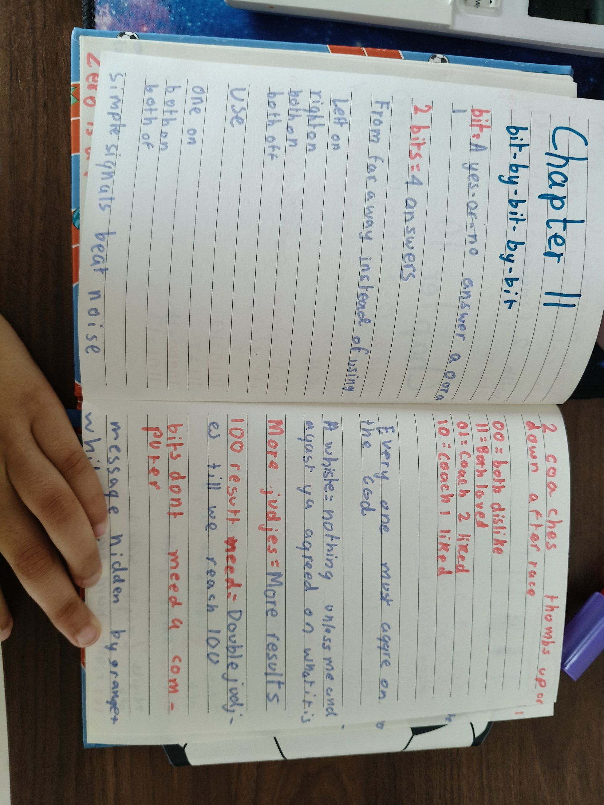
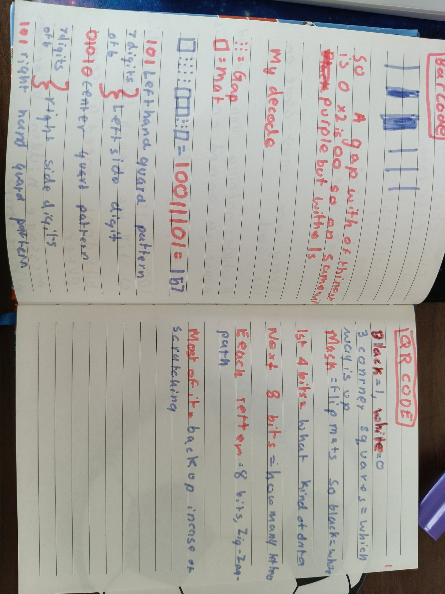
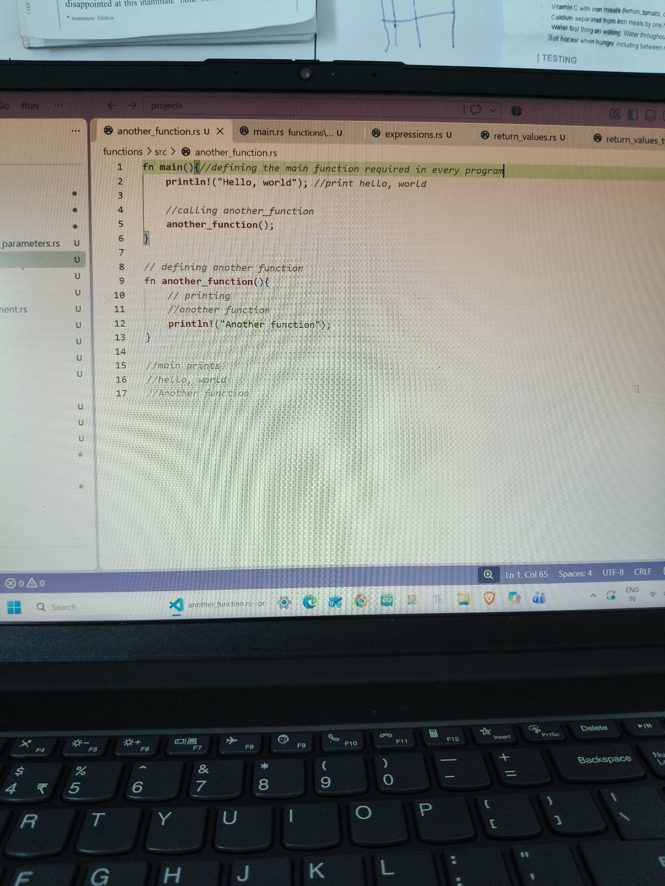

## Moonlight 🌙
I am working on a new project called **Moonlight** for the **[Startup Buildathon India 2026](https://startupbuildathon.com/)** by Google DeepMind and Google Cloud.

Moonlight looks for old medicines that might get a new job. It links a disease to a protein to medicines. Then it removes the medicines already known for that disease, like a detective crossing off the answers everyone already knows, so only the real clues are left. It is for research, not medical advice.

Papa and I are the co-founders, Mumma is the designer, and Agastya is the tester. I'm the tech lead. I code the engine: fetching, retrieving and filtering.

- [Moonlight repo](https://github.com/kashishdugar2017/moonlight)
- [Our pitch deck](https://github.com/kashishdugar2017/moonlight/blob/main/Moonlight_Pitch_Deck.pdf)

## Petzold: Bit by Bit by Bit
- Every new bit doubles the number of codes. 5 bits make 32 codes: 2, 4, 8, 16, 32.
- To give 200 things their own code you need 8 bits, because 8 bits make 256. 7 bits only make 128, so some things would have to share a code. (I needed a clue for this one.)
- **Mars parachute:** NASA's Perseverance parachute had orange and white strips. Orange is 1 and white is 0. Each group of 7 strips is a binary number, and the number is a letter of the alphabet, like 4 = D. It spelled DARE MIGHTY THINGS.
- **Barcodes:** black bars are 1 and white gaps are 0. A thick bar is a few 1s in a row. I decoded one myself: 10011101 = 157. (I needed a clue for which one is 1.)
- **QR codes:** black squares are 1 and white squares are 0. The 3 corner squares show which way is up. A mask flips some squares so black and white are even. The first 4 bits say what kind of data it is, the next 8 bits say how many letters, and then each letter is 8 bits in a zig-zag path. Most of the QR code is backup in case it gets scratched.
- The QR letter w is 01110111 = 119. I always write the place values from the right first. (I needed help adding it up.)

## Rust: Comments and Control Flow
Rust is like a combo of Arduino IDE and Python. The curly braces and semicolons are like Arduino, and `if` and printing are like Python.

- **Comments:** I tried comments at the end of a line, on their own line, and multiline ones. The compiler ignores them.
- **if:** the condition has to be a bool, because `if` asks a yes-or-no question.
- **if in a let:** `let x = if condition { 5 } else { "six" };` won't compile. 5 is a number and "six" is a string, but x can only be one type. It's like my match arms in the guessing game: they all have to give back the same type. (I needed a clue to connect this.)
- **Loops:** Python has while and for. Rust has while, for and loop.
  - `loop` = turn in circles forever, until you break
  - `while` = turn in circles till the light changes
  - `for` = turn in circles three times
- A loop can give back a value with `break`, and you store it with `let`.

