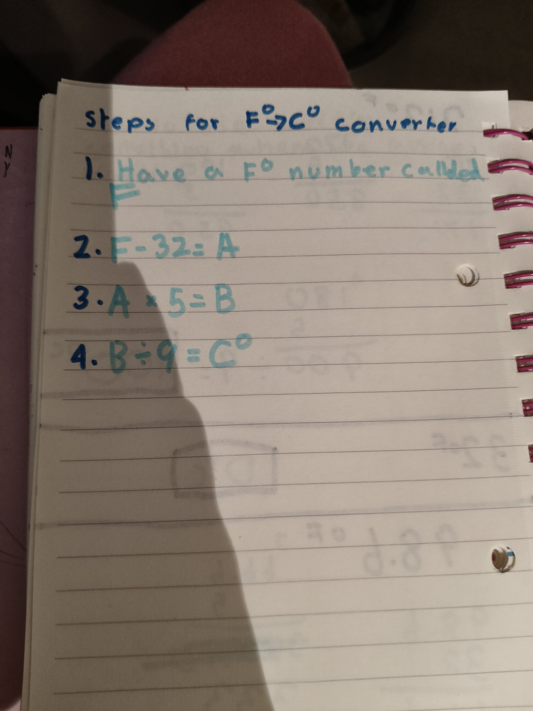
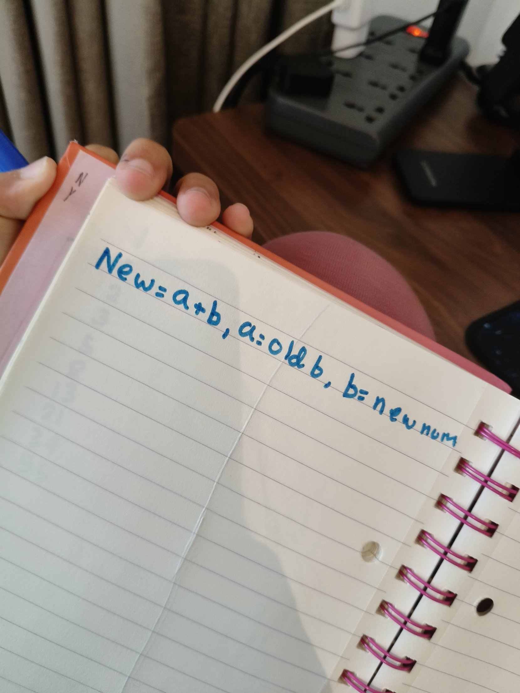
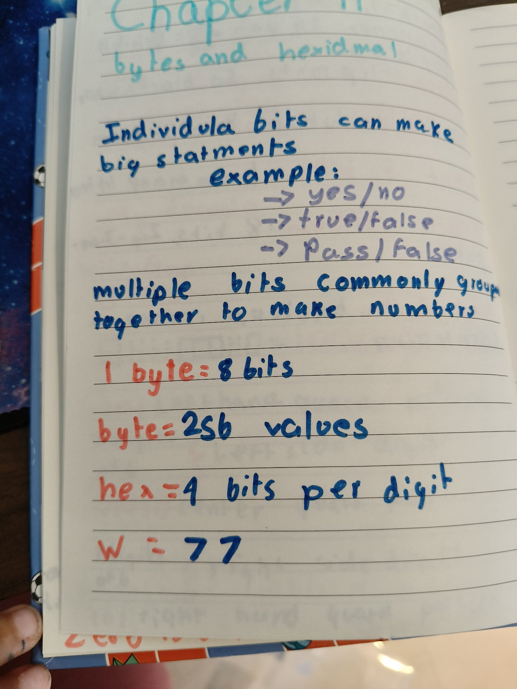

## My first own Rust programs
Today I did the Chapter 3 exercises. These are my own programs, so I wrote a plan on paper first and predicted before running.

## Temperature converter
My plan: have a °F number, take away 32, times 5, divide by 9, show the answer.

I predicted 32 °F = 0 °C, 212 °F = 100 °C and 98.6 °F = 37 °C. The first two worked. For 98.6 Rust gave an error, because 98.6 is a float and 32 is an integer, and Rust won't mix them. I fixed it myself by writing 32.0, 5.0 and 9.0. Then it printed 37!

Then I made it go the other way, °C to °F. My first try said 100 °C was 237.6 °F, which is wrong because water boils at 212 °F. I had put the + 32 first. When you reverse something, the first step goes last, like taking off swim gear. After I fixed the order it said 212.

(paste your temperature code here)

## Fibonacci
The rule: add the last two numbers to get the next one. 1, 1, 2, 3, 5, 8, 13, 21, 34, 55.

My plan: keep the last two numbers, a and b. new = a + b, a becomes old b, b becomes new. To get the 10th number you need 8 rounds, because you already have the first two. (I needed a clue for that.)

My first run printed 1, not 55. Rust's warnings said my a and b never changed. I had written `let` inside the loop, which makes a brand new a and b instead of changing the old ones. That's shadowing! I took out `let` and it printed 55.

Then I tried the 50th number. I predicted it would work, but it panicked: "attempt to add with overflow". The 50th Fibonacci number is about 12 billion, and an i32 only holds about 2 billion. I changed it to i128 and it printed 12586269025.

(paste your Fibonacci code here)

## Petzold: Bytes and Hexadecimal
- 1 byte = 8 bits, and a byte can hold 256 different values. (I needed a clue for 256.)
- Writing 01110111 everywhere is too long. Hexadecimal uses one digit for every 4 bits, so a byte is only 2 digits.
- The letter w is 01110111. Split it into 0111 and 0111, which is 7 and 7, so w is 77 in hex. (I needed a clue to put the two halves together.)

