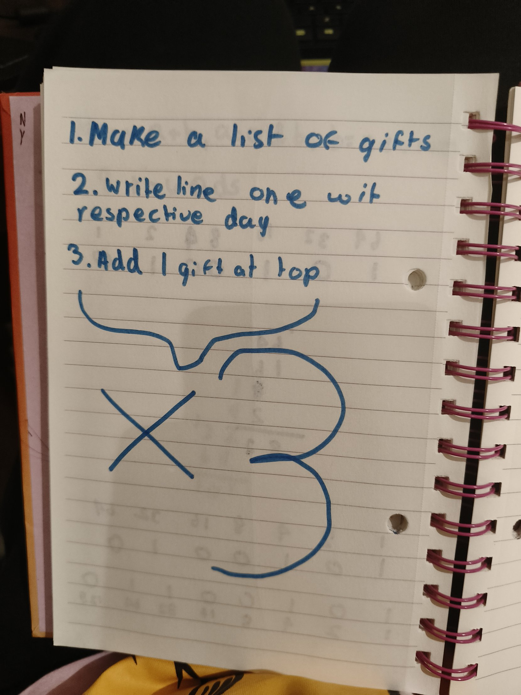
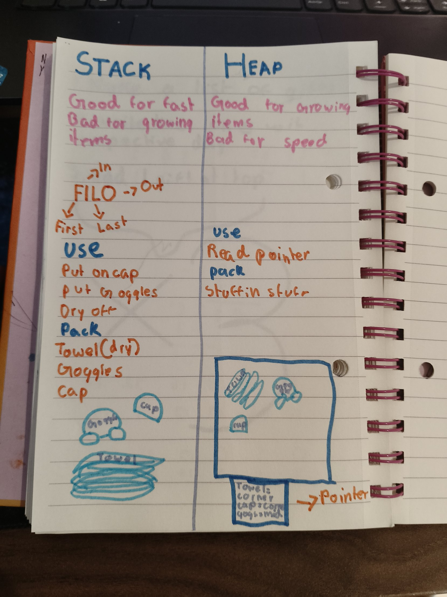

## Fixing yesterday's work
My Temperature-Converter README said the Celsius to Fahrenheit formula was `(9*5)/C+32`. With C = 100 that does not give 212, so it was wrong. I read my own code line by line and fixed it to `(C*9/5)+32`.

## Hex warm-up
- 10100110 = 128 + 32 + 4 + 2 = 166. (I needed a clue to line up the place values.)
- Split it into 1010 and 0110. That is 10 and 6, and 10 in hex is A, so it is A6. (I needed a clue that 10 = A.)
- A byte holds 256 values, because each bit doubles it 8 times. (I needed a clue.)
- 3F = 3 × 16 + 15 = 63. (I needed a clue that the left digit is ×16.)
- Hex is shorter than binary because hex has 16 digits, so one digit holds 4 bits.

## The Twelve Days of Christmas (not finished yet)
The pattern: "On the ___ day of Christmas my true love gave to me" repeats, and the gifts grow by one each day. The gifts are said newest first, counting backwards to the partridge, like LIFTOFF.

My plan: make a list of gifts and a list of days, write line one with the right day, and add one gift at the top, three times.

I made two arrays, but I got stuck on how to use a number to pick a word out of an array, and how to put it inside `println!`. Rust told me I can't use `+=` on an array, and that `{}` in `println!` only takes a plain name. I will finish it on Friday.

## Rust Chapter 4: Ownership
**Stack and heap in swim bag terms:**
- The **stack** is like packing my swim bag in order. Towel first, then goggles, then cap. The cap comes out first. That is FILO, the same as LIFO. It is fast but bad for things that grow.
- The **heap** is like stuffing everything in and hoping to find it. It is good for things that grow but slow. You keep a note saying where things are, like "towel: corner, cap: corner, goggles: middle". That note is the **pointer**.

**The ownership rules:** each value has an owner, there can only be one owner at a time, and when the owner goes out of scope the value is dropped. Like my swim bag: I am its only owner.

**Scope:** a variable made inside `{ }` stops being valid after the `}`, and its memory is deleted.