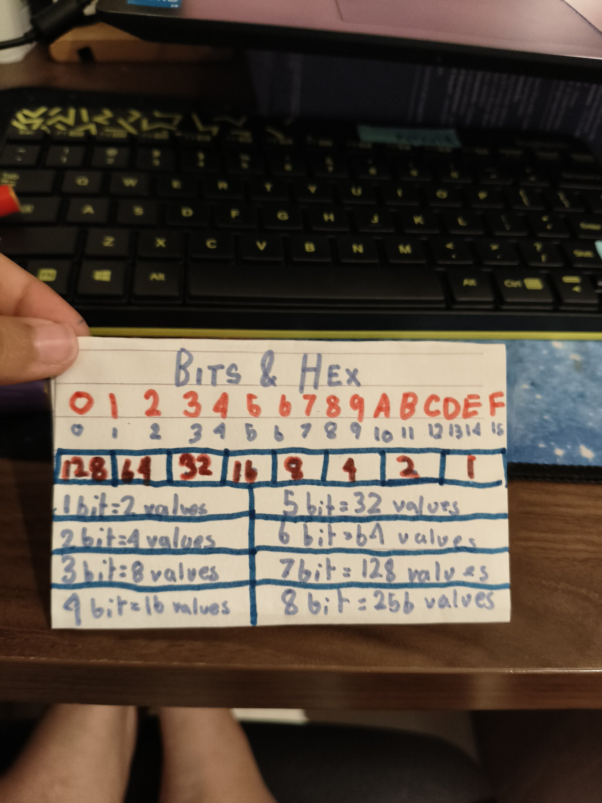
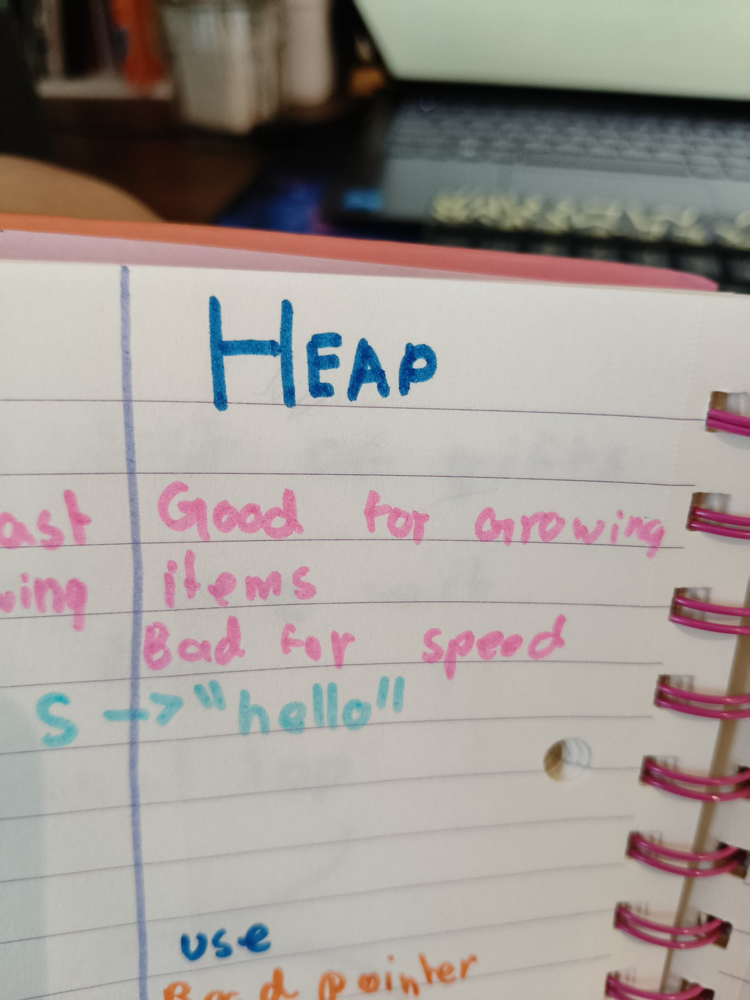

## My Bits & Hex card

Today I made a card that stays on my desk. Every number on it is in my handwriting.



- **The place-value row:** eight boxes, 1 in the right-hand box, doubling as you go left: 128 64 32 16 8 4 2 1. (I needed a clue: my first try had the 1 on the left.)
- **The doubling ladder:** 1 bit = 2 values, 2 bits = 4 values… all the way to 8 bits = 256 values. I worked out 256 myself. (I needed a clue: at first I added 2 instead of doubling.)
- **So a byte is 8 bits, and it can hold 256 values.**
- **The hex row:** 0 to 9, then A = 10, B = 11, C = 12, D = 13, E = 14, F = 15.

Then I used the card for three conversions:
- 01100101 = **101**. I did this one by myself.
- The same bits in hex = **65**. I split them into two groups of four. (I needed a clue: each group only uses 8 4 2 1.)
- Hex 2C = 2 × 16 + 12 = **44**. (I needed a clue to show the two parts before adding.)

Yesterday I also wrote "I am 9 years old." in ASCII hex, all by myself:

`49 20 61 6D 20 39 20 79 65 61 72 73 20 6F 6C 64 2E`

## Rust: The Twelve Days of Christmas, finished!

This is the exercise at the end of Chapter 3 of the Rust book. My program prints the whole song, all 90 lines.

```rust
fn main() {
    let gifts = ["a partridge in a pear tree", "two turtle doves", "three French hens","four calling birds", "five gold rings", "six geese a-laying", "seven swans a-swimming", "eight maids a-milking", "nine ladies dancing", "ten lords a-leaping", "eleven pipers piping", "twelve drummers drumming"];
    let days = ["first", "second", "third", "fourth", "fifth", "sixth", "seventh", "eighth", "ninth", "tenth", "eleventh", "twelfth"];
    for day in 0..12{
        let day_c = days[day];
        println!("On the {day_c} day of Christmas my true love gave to me");
        let gift_range = (0..=day).rev();
        for gift in gift_range{
            let gift_add = gifts[gift];
             println!("{gift_add}!")
        }
    }
}
```

What I learned:
- **The loop variable can pick from an array.** Instead of `_`, I named it `day` and used it inside the `[ ]`. (I needed a clue: the book's liftoff example shows the loop variable holding a number each time.)
- **Only a plain name goes inside `{}` in `println!`.** So I put the picked word in a variable first, then printed that name. (I needed a clue: I looked at my temperature program.)
- **The gifts count down.** On day 3 the hens come first and the partridge comes last, so I added `.rev()`, the same thing the liftoff example does. (I needed a clue to work out that it counts down.)
- **`0..=day`** gives each day the right number of gifts.
- **Index out of bounds!** Twice my range went one too far, and the program crashed with "the len is 3 but the index is 3". The indexes of 3 things are 0, 1, 2, so the range has to stop before 3. The second time, I fixed it by myself.

## Rust: The String Type

- **The three ownership rules:** every value has an owner; there is only one owner at a time; when the owner goes out of scope, the value is dropped. (I needed a clue for the third one.)
- **A String lives on the heap.** `s` sits on the stack and points to "hello" on the heap.



- **Why can a String grow but a literal can't?** The heap is good for growing things. A literal is like a cake: once it's baked into the program, it can't get bigger.
- If "hello" grew while it sat in my swim bag (the stack), everything packed on top of it would get pushed out. That's why growing things go on the heap.

## Petzold, *Code*: From ASCII to Unicode

ASCII only has 7 bits, so 128 codes. That's enough for English, but not for accented letters like ä. So ASCII is bad for countries in Western Europe like Finland, where Matti sir lives. ASCII can't even write his name, Matti Rajakylä! (I needed a clue to get 128 from my card.)

I found ASCII on my own desk! My keyboard has a $ key but no ₹ key. The rupee sign isn't in ASCII, even though I live in India. But my laptop's 4 key has a ₹ on it, and pressing Ctrl+Shift+4 types it. That's Unicode, not ASCII: ₹ is U+20B9. (I needed a clue for the code number.)

**Unicode** is better for all places. It has more bits, so it has room for more characters, even emojis. The violin emoji is U+1F3BB.

I finished Chapter 13 today.