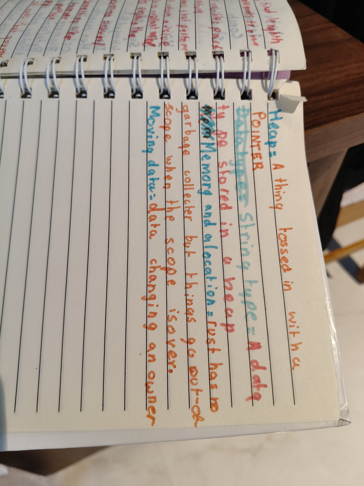
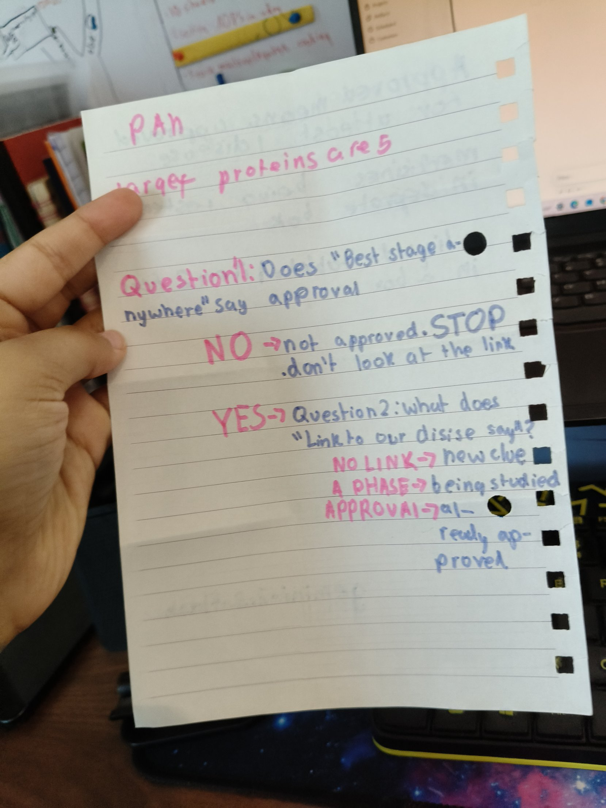
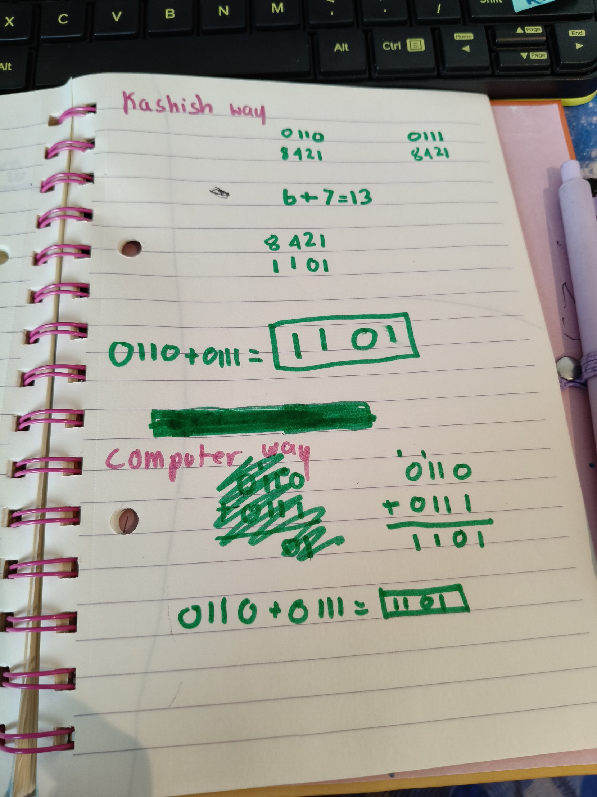

## Card drill

- I drew my eight boxes from memory with the card face down: 128 64 32 16 8 4 2 1, with the 1 on the right. Correct first time!
- 7 bits give 128 values and 5 bits give 32 values. 5 is the bits, 32 is the values.
- Hex 4B = 4 × 16 + 11 = **75**. (I needed a clue: my first answer was 15, because I forgot the left digit is worth 16s.)

## Rust: Ownership and moving data

I read "Memory and Allocation" up to "Cloning Data". My notebook lines:

- **Memory and allocation:** Rust has no garbage collector, but things go out of scope when the scope is over.
- **Moving data:** data changing an owner. (I needed a clue: in Figure 4-4, s1 is grey. Grey means s1 can't be used any more.)

I typed the book's example where `s2 = s1` and then tried to print `s1`. It did not compile. The error said: move occurs because `s1` has type `String`, which does not implement the `Copy` trait.

What I learned:
- After `let s2 = s1`, only **s2** can be used.
- Only the note card on the stack is copied (the pointer, the length and the capacity). The text on the heap is not copied. Both cards point at one "hello". (I needed a clue: I first said the bin was copied.)
- If Rust let both s1 and s2 stay valid, "hello" would be dropped twice at the closing `}`. That bug is called a double free. That is why Rust greys out s1. (I needed a clue for this one.)

## Rust: the bug in my swim program

My program asks for my event, my PB and my race time, and tells me how I did. On Saturday it looked finished.

Today I tested PB 9.80 and race time 10.20. I predicted the exact line and I was right:

`You broke your PB, your time was 10.20`

But that is wrong! 10.20 is slower than 9.80.

How I found the bug:
- `pb` and `time` were **Strings**. That is text, not numbers.
- Text is compared like words in a dictionary, letter by letter. "10.20" starts with 1 and "9.80" starts with 9, and 1 comes first. So the program thought 10.20 was smaller. (I needed clues to get here.)
- My program compared the times as **words**, but it should compare them as **numbers**.

The fix was in my own guessing game: the line that turns typed text into a number. Times have decimals, so I need **floats**. I used `f32`.

Then I got a new error: cannot `continue` outside of a loop. The guessing game uses `continue` inside a loop, and my program had no loop. I chose to add a loop.

Then I upgraded it: it now asks for the distance and the stroke, gives a tip for each stroke, and asks if you want to do it again. My freestyle tip: "Kick mad, fast, short and snappy. Powerful pull. Head steady. Don't breathe."

I have not run the new version yet. That is tomorrow's first job.

## Moonlight: reading the sorting tray

This week I am reviewing Moonlight's own code before the Buildathon. Today's file was `filter.py`. It is my two-question map, written in Python by an agent. It was not as complicated as I thought!

I matched my map to the code:
- NO → not approved, STOP: line 33. (I needed a clue for this first one.)
- No link → new clue: line 45
- Approval → already approved: line 47
- A phase → being studied: line 49
- I also found `unclear_link` on line 51, which is not on my paper map.

Then I predicted five medicines and checked myself against the tests:
- Avanafil → new clue. The test agreed.
- Udenafil → being studied. The test agreed.
- BQ-123 → I said being studied. **The test said not approved.** Its best stage is only Phase 2, so Question 1 says STOP and the link is never looked at. My own map says that too!
- Macitentan → already approved. It has no test of its own, but I found the Tadalafil test, which is the same case.
- A medicine withdrawn in one country → not approved. That was my decision on 15 November.

If Open Targets did not say whether a medicine was withdrawn, the code does not guess. It carries on to Question 2. (I needed a clue: I first thought it would treat it as withdrawn.)

**I found a comment that is out of date.** It says "Only these two are ever shown". But since 13 November the page has 3 tabs, and Approved is shown too. I wrote a ticket for it.

- One trick I would reuse: each rule is only one or two lines.
- My question: why didn't the agent change the comment when the code changed?

## Petzold: ASCII, Unicode and adding in binary

- 7-bit ASCII has 128 codes. It can't write Matti sir's surname because it has no accented letters. (I needed a clue: I said 256 first, then checked my card.)
- Unicode has all characters. That is why it is called Unicode: it is universal.
- I asked if Hindi needs accented letters. It doesn't: it needs a whole different alphabet, and ASCII has none of it.
- Capital A is hex 41 = `01000001`. Small a is hex 61 = `01100001`. Only one bit is different: the 32 box. (I needed a clue to find which box.)

Then I added in binary, two ways:

- **Kashish way:** turn both into normal numbers, add, and turn the answer back. 0110 + 0111 is 6 + 7 = 13 = `1101`.
- **Computer way:** in columns from the right, carrying. 1 + 1 = 10, so write 0 and carry 1. 1 + 1 + 1 = 11, so write 1 and carry 1. I got `1101` again!
- I did one more by myself: 0101 + 0011 = `1000` (5 + 3 = 8), both ways.

When you add two bits, the carry is 1 only when both bits are 1. That is an AND gate.
