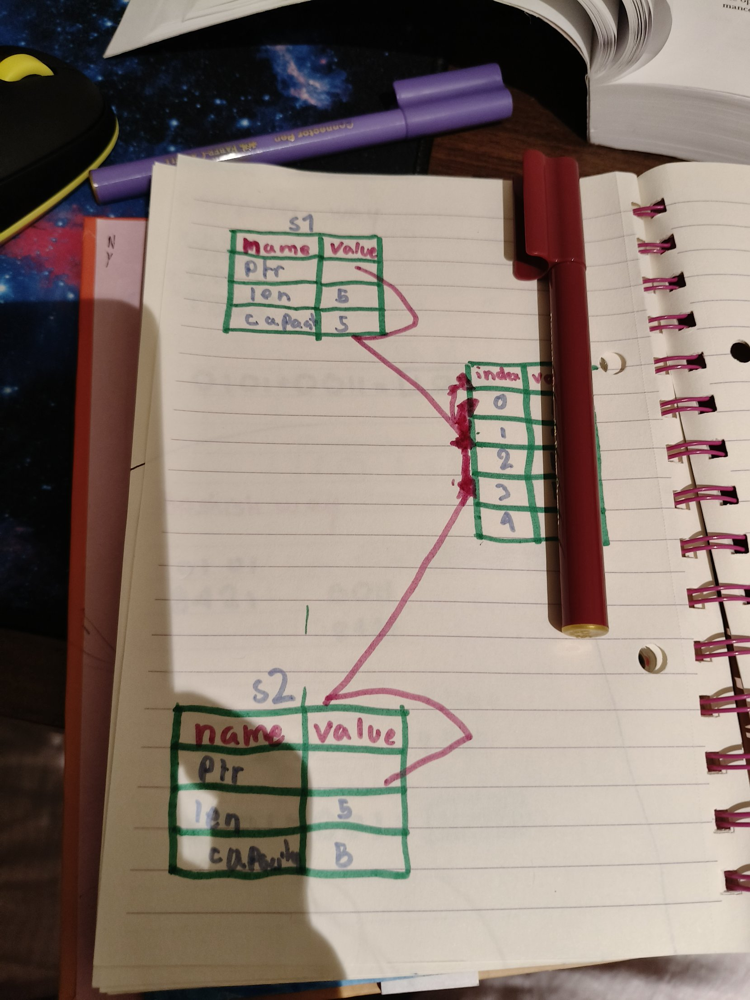
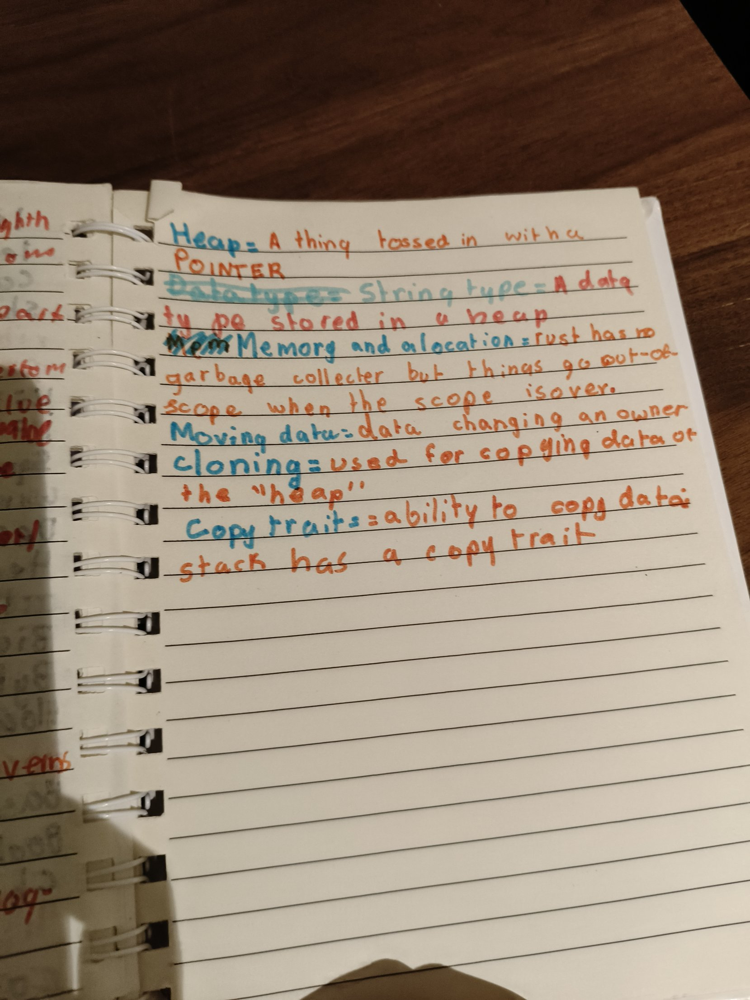
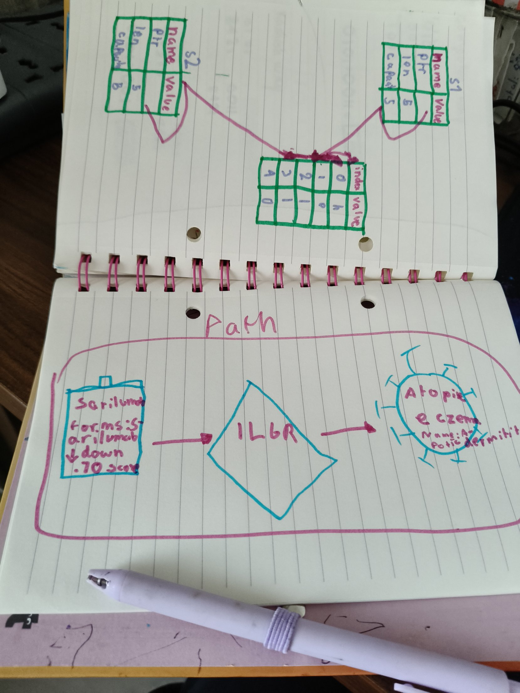
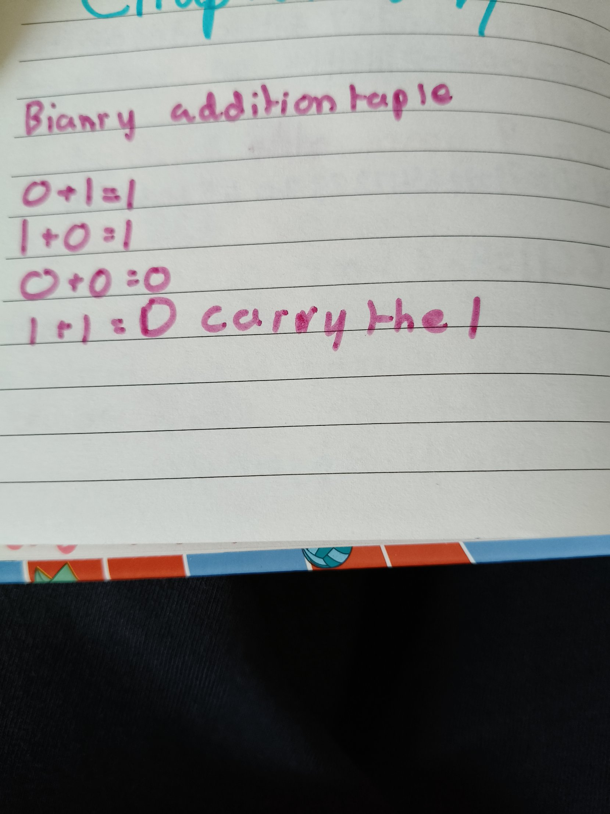

## Card drill

- Eight boxes from memory, card face down: 128 64 32 16 8 4 2 1. Right again, two days in a row.
- Hex 3A = 3 × 16 + 10 = **58**.

## Rust: what really gets copied

Two cold questions with the book closed, and I missed both. So I redrew the book's picture of s1 and s2 in my own notebook.

Then I answered them from my own drawing:

- On `let s2 = s1`, the **s table** is copied: the pointer, the length and the capacity. The text "hello" is not copied. (I needed a clue: I counted what exists twice in my drawing.)
- If both s1 and s2 stayed valid, "hello" would be dropped **twice** at the closing `}`. That is a double free.

Then I read "Cloning Data" and "Copying Stack-Only Data" and typed both examples.

- **Cloning:** used for copying data of the heap.
- **Copy trait:** the ability to copy data. Things on the stack have the Copy trait.
- `let y = x` works for 5 because an integer implements the Copy trait. The whole 5 lives on the stack. A String's text lives on the heap. (I needed a clue for the stack and heap part.)
- If I want two separate Strings, the word is `clone`. Rust does not do it for me because that code may be **expensive**. (I needed a clue: I found the word on page 70.)

## Rust: eleven errors in my swim program

Yesterday I added stroke tips and a "do it again?" question, and never ran it. Today I predicted the first error before running: no semicolon after a print. I was right!

There were 11 errors. I fixed all of them by myself in six minutes. I even used `clone` from this morning's reading.

Then I tested it and found three bugs myself:
- the tip was missing
- "freestyle" printed "Invalid stroke"
- the yes/no question did not wait for me

How I fixed them:
- The yes/no question never read my answer. I added the lines that read it.
- "yes" still printed "Bye race well!". The reason: when I press Enter, the Enter goes into the String too. So "freestyle" plus an Enter is not equal to "freestyle". (I needed a clue to see it was the Enter.)
- The word that cuts off the Enter is `trim`. It was already in my own PB line. I got the trim working on my own.

Now the tip prints, "yes" goes round again, and the PB check is right for a faster time and a slower time.

One line in my output still should not be there. Finding it is tomorrow's first job. (I also ran four times without a PREDICT first.)

## Moonlight: the five boxes

Today's file was `records.py`. Before opening it I drew one clue from the Moonlight app: Sarilumab → IL6R → atopic eczema.

The file has five boxes: Disease, Target, MedicineForm, Medicine and Path.

- **Path** holds the whole chain: the medicine, the protein and the disease. It also holds the score and the direction. (I needed a clue: I had put those inside the medicine box.)
- **The ladder:** Approval is stronger than Phase 3. Phase 2/3 is stronger than Phase 2. Phase 1 is stronger than no stage at all. I got all three.
- **The family rule:** if Sildenafil says Phase 3 and Sildenafil Citrate says Approval, the family says Approval.
- If Open Targets did not say whether one form was withdrawn, the family says **not known**. It does not guess. (I needed a clue: I said "not withdrawn".)
- **Up or down:** an inhibitor is down and a binding agent is unknown. For an agonist and an inhibitor together I said down. I searched the tests for "together" and found the answer myself: it is **mixed**.
- `frozen=True` means the box cannot be changed after it is made. It is like a Rust variable without `mut`.

My question: how does simple code like this make Moonlight?

## Petzold: dolphin school

- 7-bit ASCII has 128 codes. I got it with my card face down.
- In one column, 1 + 1 + 1: write 1, carry 1.

I read pages 169 to 171 of "Adding with Logic Gates". Dolphins have two flippers, so Petzold pretends they count in binary. In dolphin school they learn this table:

The adding machine has two rows of eight switches and **nine** lightbulbs. The extra bulb is for the last carry.

I want to build this adding machine.
