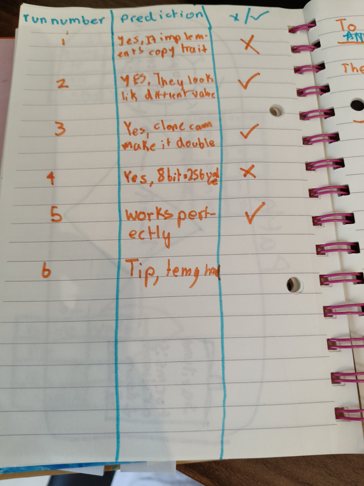
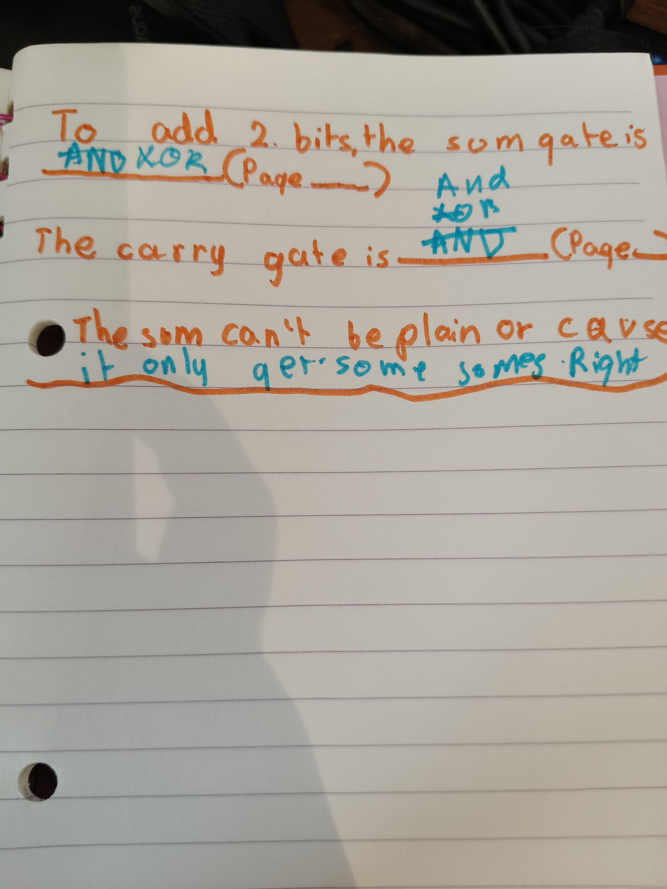

## Card

Hex 6D = 6 × 16 + 13 = **109**. I gave the two parts first this time.

## Rust: my PREDICT scorecard

Today I started a scorecard. Every run gets a row: my prediction, then a tick or a cross. A run with no PREDICT before it does not count.

The first four rows were "will this compile?" questions:

1. `let s2 = s1;` and then print `s1`. I said yes. **Cross.** The value moved to s2, so s1 cannot be used.
2. `let x = 5; let y = x;` and print both. I said yes. **Tick.** It printed `5 5`.
3. `let s2 = s1.clone();` and print both. I said yes, clone can make it double. **Tick.** It printed `hi hi`.
4. `let n: u8 = 256;` I said yes, because 8 bits = 256 values. **Cross.** The 256 values are 0 to 255, because counting starts at 0. So 256 does not fit.

The two cold questions from Monday and Tuesday: I missed both again. Then I put my finger on my own drawing and followed the arrows. Both arrows end at the same text. So the **table** is copied, not the text, and "hello" would be dropped 2 times. (I needed a clue.)

**Ownership and Functions:** s's value moves into the function, so main cannot use it after. An i32 implements the Copy trait, so x can still be used. (I needed clues: at first it made zero sense. The sense was in the comments of Listing 4-3.)

## Rust: the last bug in my swim program

My program printed "Invalid stroke" after every tip. I found why: the `else` belonged only to the IM `if`. So it meant "if the stroke is not IM, print invalid".

The fix is `else if`: one `if`, four `else if`s and one `else`, so only one of them runs. (I needed a clue for where to find it in Chapter 3.)

Then I tested it with predictions:
- A stroke that is not on my list printed "Invalid stroke". Tick.
- Butterfly printed its tip and nothing else. Tick.
- A race time the same as my PB printed "Congrats, try a teeny bit harder". Tick.

Some of my runs did not count, because I ran before I typed PREDICT.

Ideas for tomorrow: stop after an invalid stroke, and emojis.

## Git: my first commit from my own computer

I opened my Temperature repo on GitHub. Line 3 adds 32 first, so 100 C prints about 237.6. The right answer is 212. My blog said I fixed it, but the wrong file is on GitHub. Nobody did it on purpose. Uploading files by hand makes that easy to do.

It is like a swim meet. Writing a time on paper by hand can go wrong. The touchpad sends the time straight to the scoreboard. Git on my computer is the touchpad.

Why I use Git now, in my words: to update daily instead of practically breaking the repo. If I add emojis, there is no re-uploading and no time wasted.

Each save is called a commit, and it keeps my note. My first note: **"finished my swim program alone and ran it"**. My new repo is `swim_celobrator`. From now on a change is three steps: type a note, Commit, Sync.

## Moonlight: which clue comes first

First I wrote a ticket for the out-of-date comment in `filter.py`:
- **GOAL:** Change the comment so it says 3 tabs.
- **CHECK:** Look where we wanted to change it, `filter.py` line 20.

Then I read `rank.py`. My ranking rules from memory: score, reports, a-z. They are on lines 107, 108 and 109.

- The minus sign in front of the score is there to reverse it, so the highest score comes first.
- I ranked four by hand: Gamma (rule one), Delta (reports), Alpha, beta (a-z). Capital and small letters do not matter: the test says "alphabetical ignores case".
- One machine counts once. Proteins scoring 0.60 and 0.50 in the same machine, plus 0.30 in a different machine, make **0.90**, not 1.40. If 2 parts are the same machine, choose the higher. Add only if it is different.
- `by_family` is a dict where each value is a list. A dict is a hash table, and I built one. It is the same shape as my Breadth-First-Search graph. (I needed a clue for the graph.)
- `machines` is the hardest part: paths go in, and groups come out, one group per machine. (I needed a clue.)

My question for the agent: what is `same_machine_ids`?

## Petzold: my parts list for the adding machine

- To add 2 bits, the **sum** gate is XOR and the **carry** gate is AND. (I needed clues, and I had them swapped at first.)
- The sum can't be a plain OR because it only gets some sums right. OR gives 1 for 1 + 1, but the sum digit should be 0.
- One XOR is made of an OR, a NAND and an AND.
- The whole 8-bit machine needs 144 relays! My idea: get Python or Rust to do it.

## Corrections

Three things I wrote before that I now know better. (I needed clues to find them.)

- **Day 19:** I said putting 256 in a `u8` crashes while the program runs. Today Rust stopped it before it ran.
- **Day 25:** I said things on the stack have the Copy trait. Not everything. A String's table is on the stack, but a String moves.
- **Day 23:** I said only a plain name goes inside `{}`. An empty `{}` prints whatever comes after the comma, even a sum like `y + 2`.
