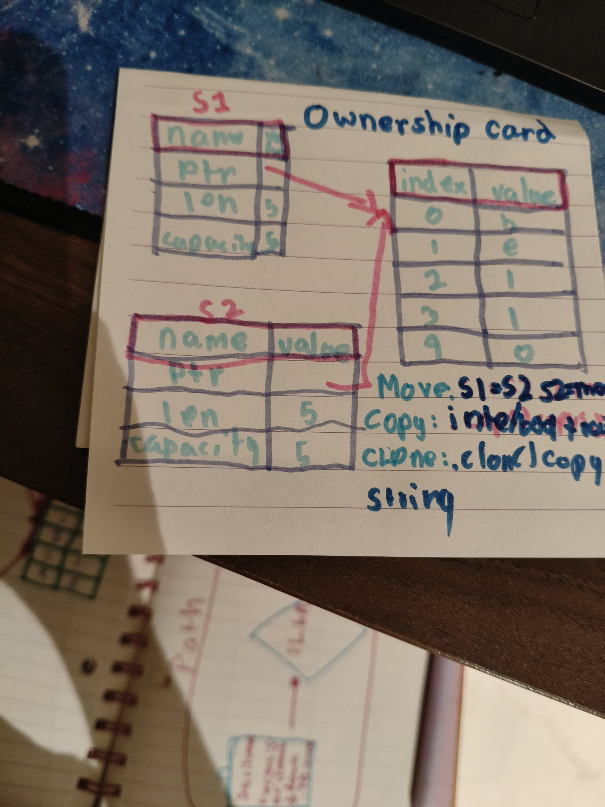
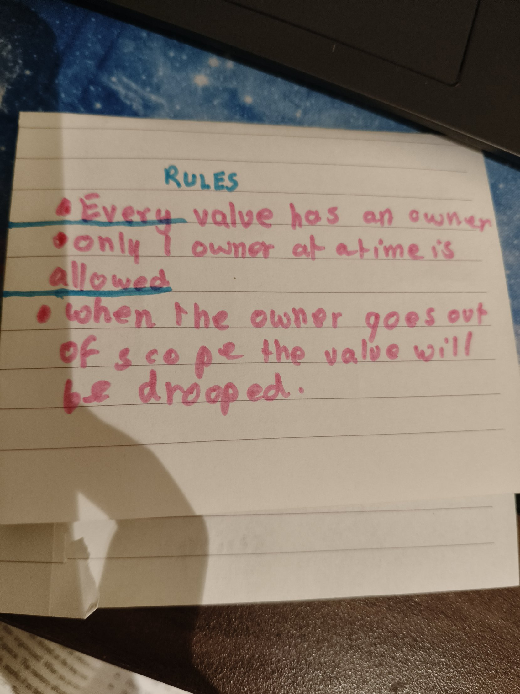
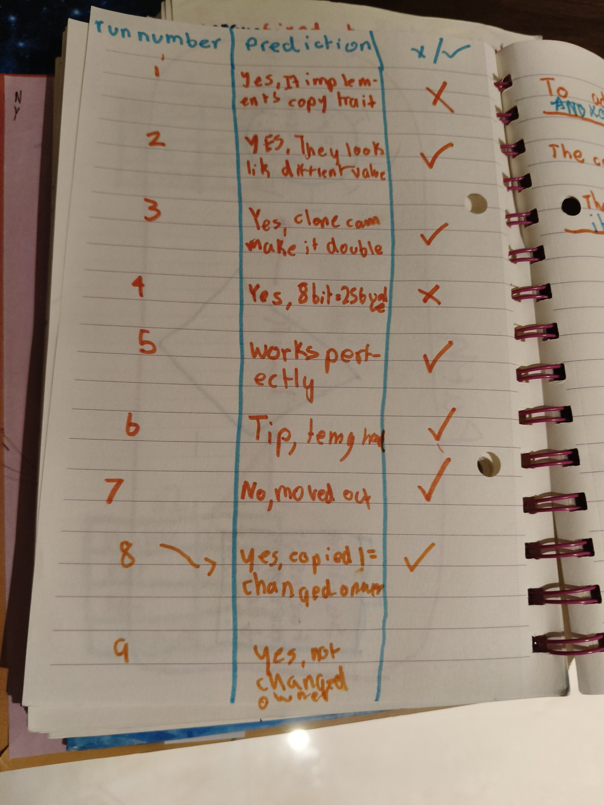
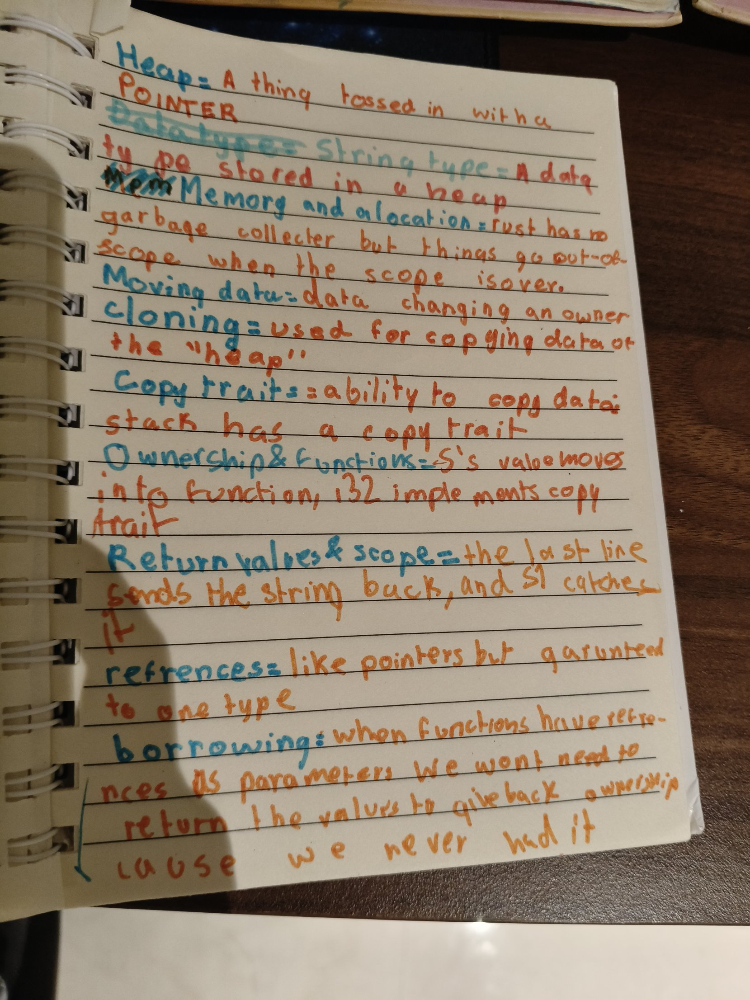
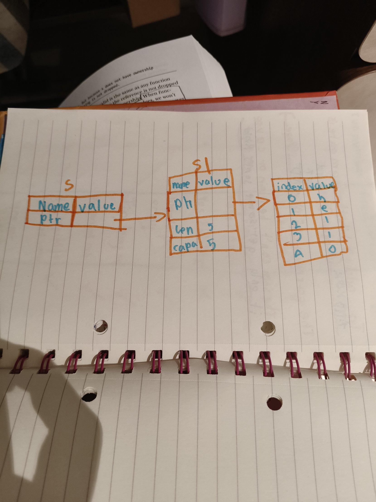
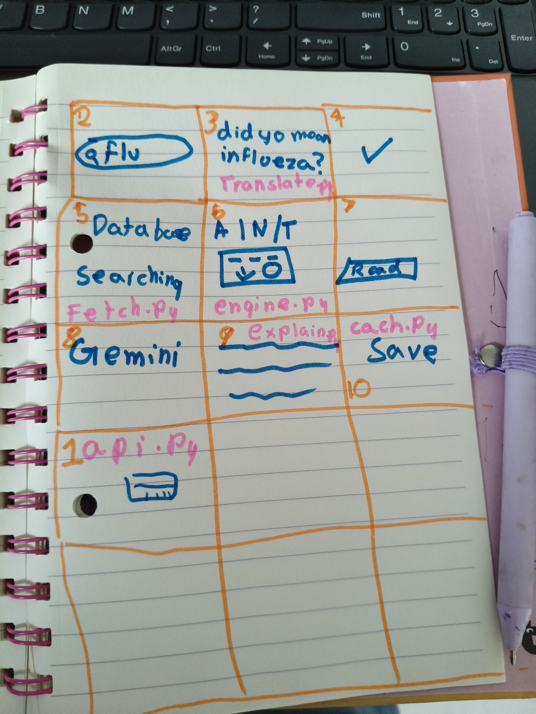
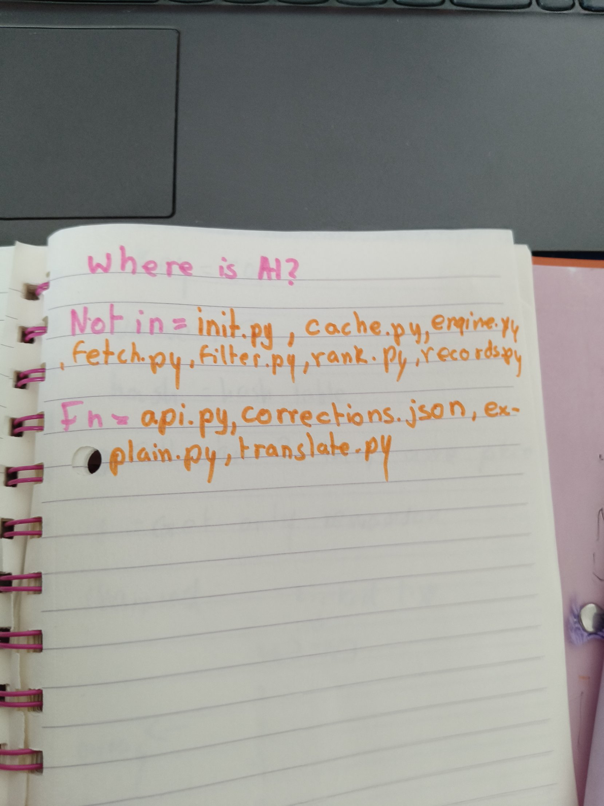
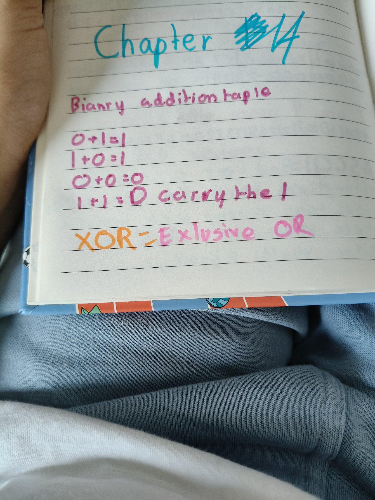

## My ownership card

I made a card that stays on my desk, like my bits card. One side has my drawing: s1, s2 and the text. Both arrows point at the same text.

 The other side has the three rules in my words:

- Every value has an owner.
- Only 1 owner at a time is allowed.
- When the owner goes out of scope the value will be dropped.

Two questions, with my card:

- On `let s2 = s1`, the small table (ptr, len, capacity) is copied. The text is not. (I needed a hint. I guessed fast two times first.)
- If s1 and s2 both stayed valid it would break rule 2. (I said rule 1 first.)

## Rust: Return Values and Scope

My notebook line: the last line sends the String back, and s1 catches it. (I needed clues to find the line in the book.)

Two "will this compile?" rows on my scorecard:

- Print `x` after `makes_copy(x);`. I said yes, copied is not the same as changed owner. **Tick.** It printed 5.
- Print `s3` after `let s3 = takes_and_gives_back(s2);`. I said yes. **Tick.** It printed hello. But my reason was wrong: the owner did change. s2 moved into the function and the return value moved into s3. (I needed a clue.)

## Yesterday's extra session

Yesterday evening I typed Listing 4-3 and Listing 4-4 from the book. I predicted that `s` "got moved out" after `takes_ownership(s);`, so printing it would not compile. **Tick.** The compiler gave error E0382.

## Rust: References and Borrowing

My notebook lines:

- References = like pointers but guaranteed to one type.
- Borrowing: when functions have references as parameters we won't need to return the values to give back ownership, cause we never had it.

I typed the `calculate_length` listing with `&s1`. It ran first time and printed that the length of 'hello' is 5.

Then Listing 4-6, where a function tries to change a String it only borrowed. My PREDICT: it will not work, because we changed something we are borrowing, like we borrowed a water bottle to use and painted it. **Tick.** Error E0596.

I drew the book's picture: s points to s1, and s1 points to the text.

Quiz:

- `&s1` is a reference. s1 still owns the String. (First I said & means add. I needed a clue from my own notebook.)
- When the function ends, the String is not dropped, because s is not the owner. (First I said yes. Rule 3 on my card says *owner*.)
- In my swim program, the `&` in `&stroke` is a reference, pointer-like.

## Git: commits two and three

I added to my swim program: a title, a `break` after "Invalid stroke", and emojis.

- PREDICT: an invalid stroke prints "Invalid stroke" and then it breaks. **Tick.** (I typed "doggy".)
- PREDICT: freestyle, PB 20, time 40 prints the go home line. **Tick.** It printed "Go back home and try again".
- One run did not count, because I ran before I typed PREDICT.

A grey square showed next to my emoji. It was the skin tone, which the terminal cannot draw. I changed it, and that was its own commit.

My repo now has 3 commits, each with my own note. On GitHub I can now see the commits, which I could not when I uploaded by hand.

## Moonlight code review 4: the relay

First I drew, from memory, what happens when someone types "flu" and presses search. Then I read the top of each file and wrote the file names on my boxes: api.py, translate.py, fetch.py, engine.py, explain.py and cache.py.

**Where is the AI?** I searched every file for "gemini". It is in api.py, explain.py and translate.py. It is not in filter.py or rank.py, and those two decide what is shown and in what order. (I needed a hint for rank.py.) So Gemini never decides what is shown.

**The golden test:** sildenafil must be found on the way. The right answers come from my own paper graph. (First I said Open Targets. I needed a clue: line 1.)

On Tuesday I asked: how does simple code like this make Moonlight? My answer: each code does a tiny part to make up a bigger thing, like those singing fish making a hum.

## Petzold, Chapter 14

I read pages 174 and 175 about five times. I wrote the binary addition table: 0+1=1, 1+0=1, 0+0=0, and 1+1=0 carry the 1. XOR means exclusive OR. From my parts list: XOR gives the sum and AND gives the carry. (I needed a clue to join those up.)

