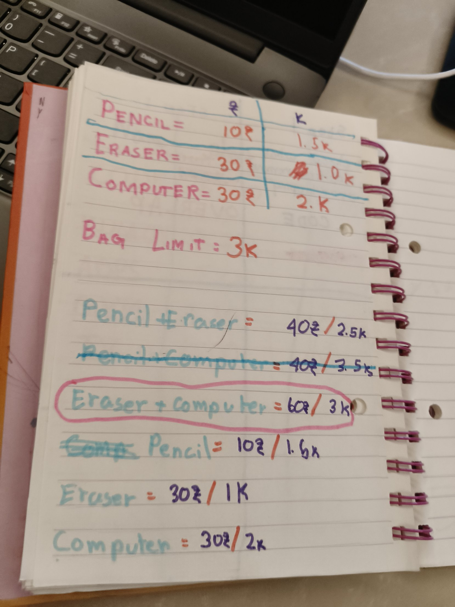
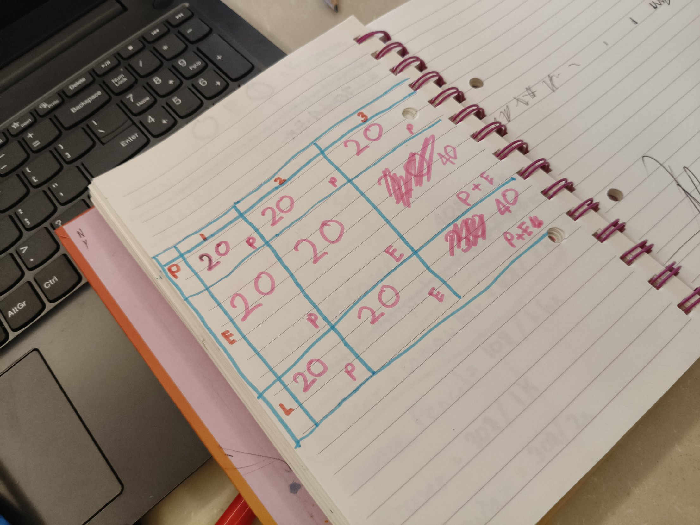
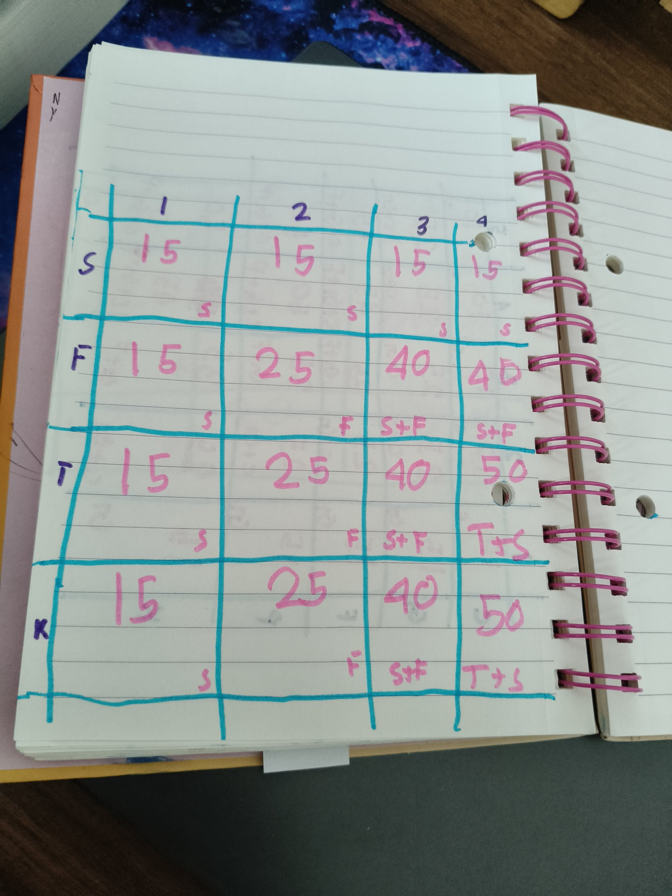

On Saturday I found that greedy can fail. Today I learned how to always find the best answer.

## Brute force
I made a new knapsack: a pencil (₹10, 1.5 kg), an eraser (₹30, 1 kg) and a computer (₹30, 2 kg), with a 3 kg bag. I listed every combination, including all three together and the empty bag. The best was eraser + computer = ₹60.

Listing everything is called brute force. It always works, but each new item doubles the number of combinations. 3 items have 8 combinations, 10 items have 1024, and 20 items have over a million!

## The grid
Dynamic programming uses a grid instead. The rows are items and the columns are bag sizes. Each box answers a tiny question: "If I only own these items and my bag is this big, what's the most I can carry?"

At first the grid felt like nonsense. I only put one item in each box, but a box can hold the best combination, like pencil + eraser.

## The rule
Each box = the bigger of:
- skip this item: the box above
- take this item: its value + the best for the space left

The grid remembers the small answers, so you don't have to list everything again.

Then I did a swim bag on my own: snorkel, fins, towel and kickboard in a 4-slot bag. Greedy would grab the kickboard (45). My grid found towel + snorkel = 50.

## Relays
I read Petzold Chapter 8. A relay has a coil that becomes an electromagnet and pulls a switch, so one circuit can control another. Relays in a line make AND, side by side make OR, and a NOT gate flips on to off. Chains of gates can flip millions of switches faster than a human could flip 3.

## What's next
Turn my grid into code.