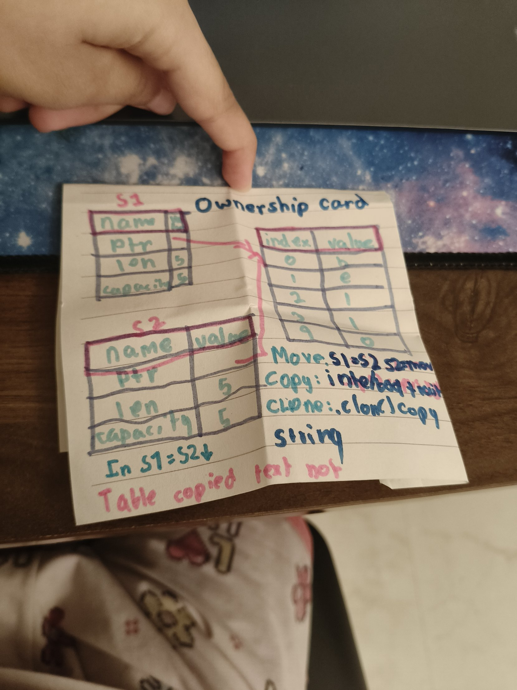
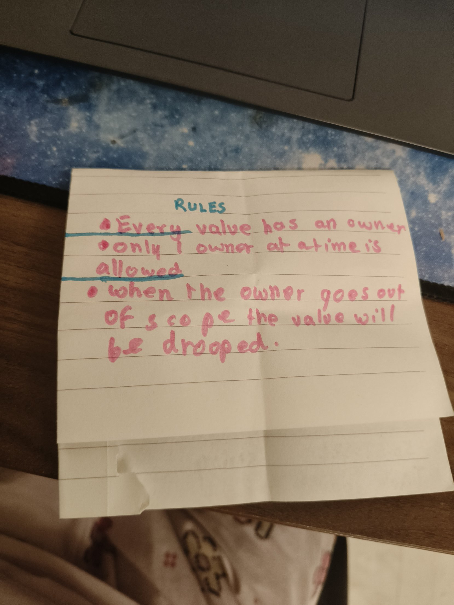
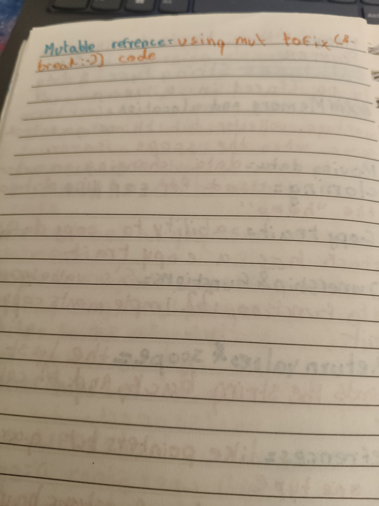
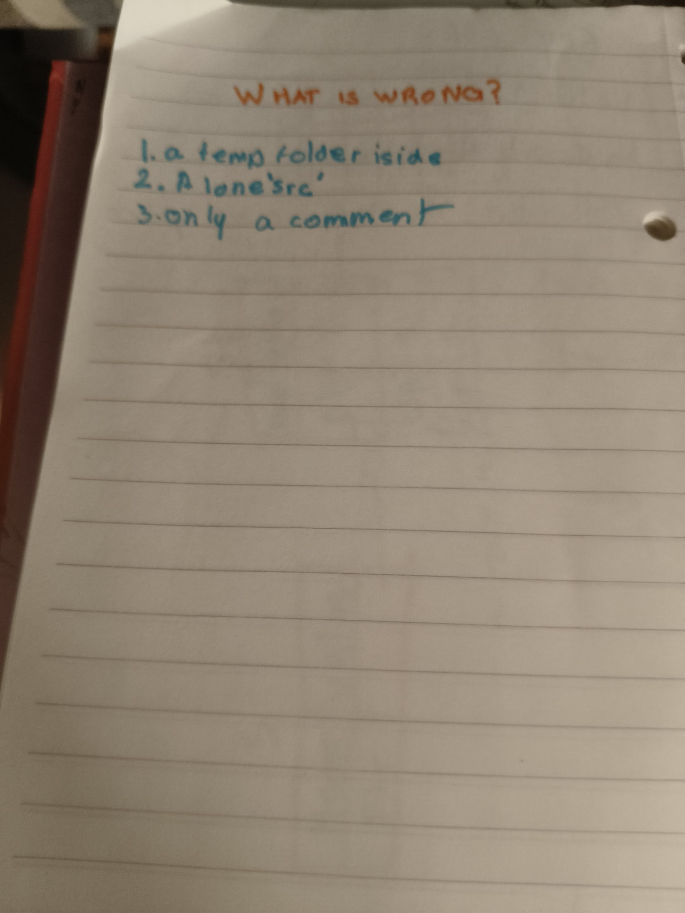
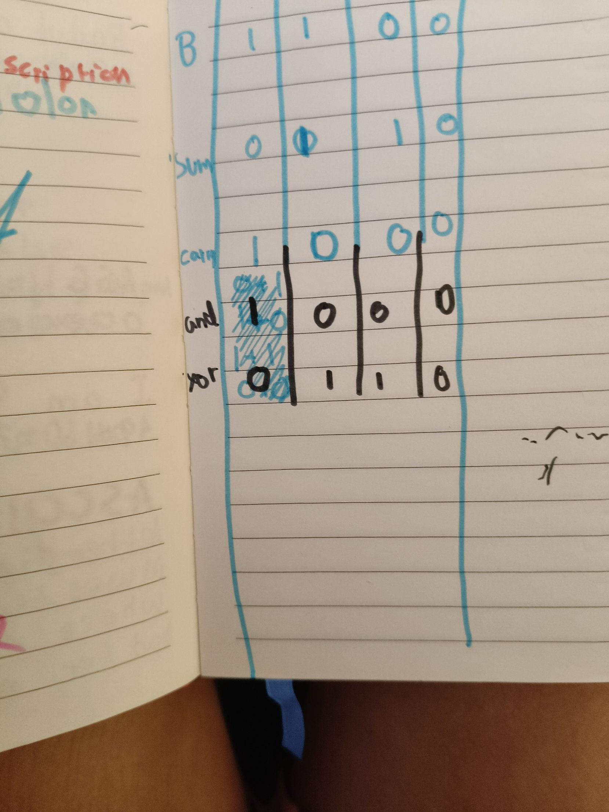
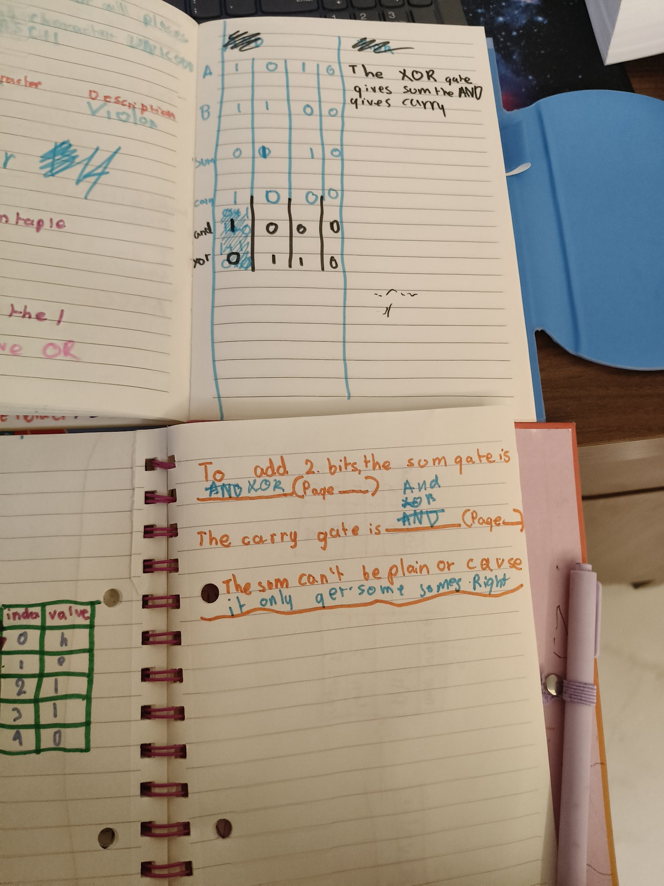
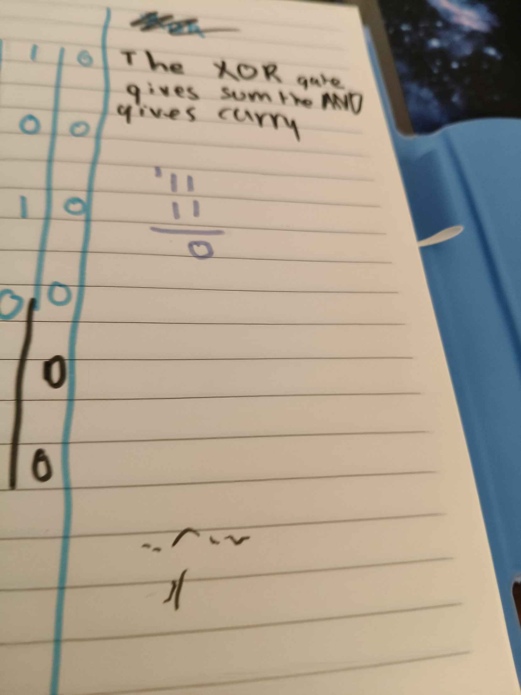

## My ownership card
I fixed my MOVE line. The book says `let s2 = s1`, and after that you can't use s1. I also added "Table copied text not".

Two questions, card first:
- On `let s2 = s1`, the table is copied. The text is not. (I needed a hint: my own pink line.)
- If s1 and s2 both stayed valid there would be two owners. That breaks rule 2. (No hint this time.)

## Rust: Mutable References
My notebook line: Mutable reference = using mut to fix (& break) code.

- PREDICT: the fixed Listing 4-6 compiles, because we made it changeable. **Tick.**
- I added `mut` in 3 places: while defining s, while changing s, and as the parameter.
- Only 1 mutable reference to one thing at one time. Two `&mut` to the same `s` is not allowed. (I needed a clue. First I said two owners.)
- If two readers are looking and someone wants to change it: not allowed.
- A reference stops counting after it is last used, like the println.

## Git: Temperature-Converters from my computer
I cloned my repo onto my computer and wrote a list, "What is wrong?": a temp folder inside, a lone `src`, only a comment.

- PREDICT: 100 C prints 212. **Cross.** It printed 237.6, as the formula was wrong. (I needed a clue to look in my README.)
- PREDICT: it will not compile, float and integer. **Tick.**
- One run did not count, because I ran before I typed the exact line.

Then it printed 212 and I committed with my own note: "changing to fix it". I also wrote a README for my swim program.

## Petzold, Chapter 14
I made a table and was the gates myself. Sum is from the XOR gate, carry is from the AND gate. (I needed a clue to see it.)

In 11 + 11 the second column is 1+1+1. One adder is not enough there because there is an extra bit.

## Moonlight
"gemini" is in `corrections.json` 0 times. My ticket for `filter.py` line 20 is not done yet.

## Buildathon
There was a lot of waiting. The day before yesterday we came, heard the briefing and left. We had finished before yesterday, so we hung around waiting, and we didn't get shortlisted.
