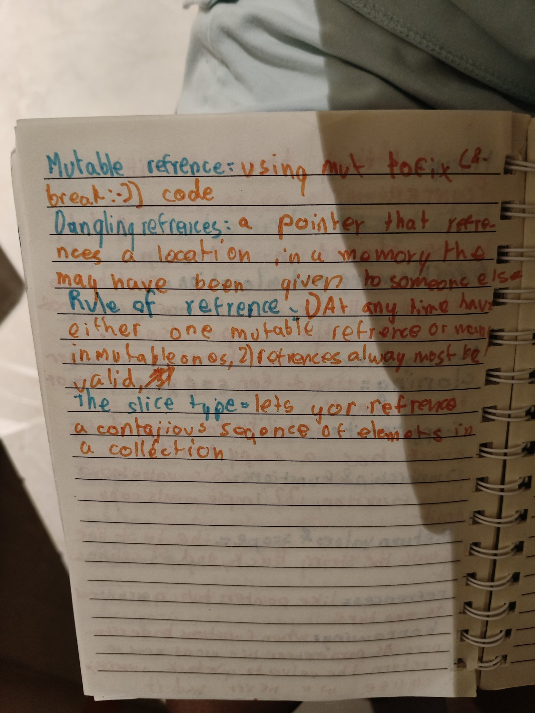
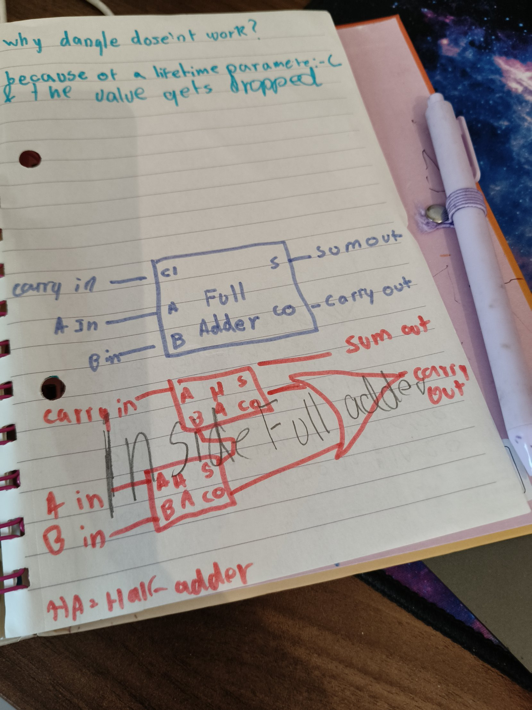
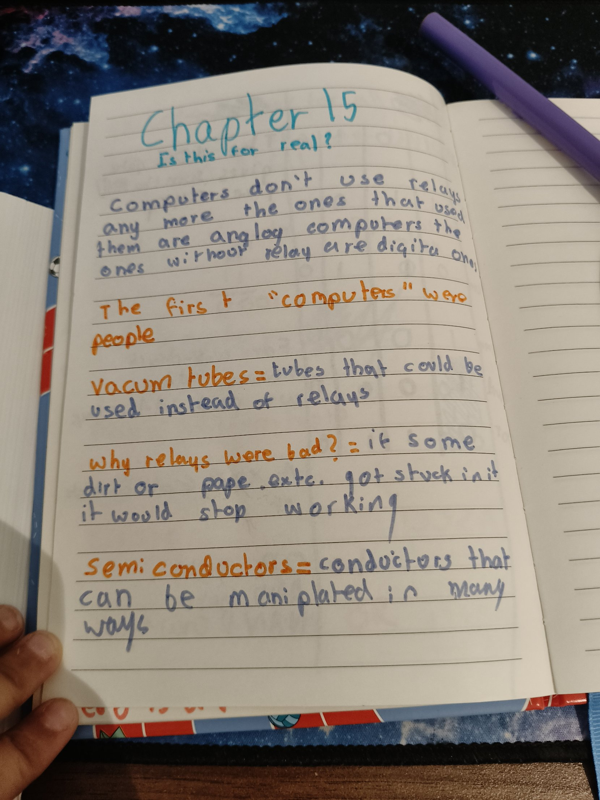

## Warm-up
- On `let s2 = s1`, s1's small table is copied. The text is not. (No hint today. I was reminded to point at my card first.)
- Why does Rust refuse two `&mut` to the same `s`? I said two owners. That is not it. I still have to get this one.

## Rust: Dangling References, The Rules of References, The Slice Type
My notebook lines:
- Dangling references: a pointer that references a location in memory that may have been given to someone else.
- Rules of references: at any time have either one mutable reference or many immutable ones. References must always be valid.
- The slice type lets you reference a contiguous sequence of elements in a collection.

Why `dangle` doesn't work: when the function ends, `s` goes out of scope and the value gets dropped. (First I wrote the word lifetime, which the book explains later.)

- PREDICT for the fix: work, did direct. **Tick**, with a warning.
- I typed Listing 4-7. It is only a function, so `cargo run` said the main function was not found.

Questions at the end:
- Inside `dangle`, `s` is dropped. That is rule 3 on my card. (I said rule 2 first.)
- The fix hands back the String itself, not a reference, so the owner moves out to `main`. (I needed three tries and one hint to name the new owner.)
- In Listing 4-8, after `s` is cleared it has nothing in it, but `word` still exists and still says 5. (I needed one hint.)
- The book's answer to that problem is string slices. (I said lifetime first.)

## Petzold, Chapters 14 and 15
I remembered without my notebook: sum = XOR, carry = AND.

11 + 11: I wrote 1000 first. I checked with my Bits card. 1000 is 8, and three plus three is six, so the answer is 110.

I read from page 176 to page 189. For an 8-digit binary adder we need 144 relays. I copied the Full Adder and what is inside it: two half adders and an OR gate.

Chapter 15 is called "Is This for Real?". The first "computers" were people. Vacuum tubes could be used instead of relays. Relays were bad because if some dirt or paper got stuck in one it would stop working.

## Git: my F to C program
Both my files were C to F, even the one named `f_to_c`. I found that myself. My formula on paper: (F - 32) × 5 ÷ 9.

- PREDICT: yes, it compiles. **Tick.**
- PREDICT: 212 gives 100. **Cross.** It printed "100.0 f is 212C" because I was printing `f`. My prediction found the bug.
- PREDICT: yes, it compiles. **Tick.** It printed "100.0 f is 100c", and the 100.0 was not true, so I fixed the words.
- PREDICT: 212.0 F is 100.0C. **Tick.** It printed "212.0 f is 100c".
- One run did not count, because I ran before I typed the exact line.

I committed with my own note: "fixing to make 2".
