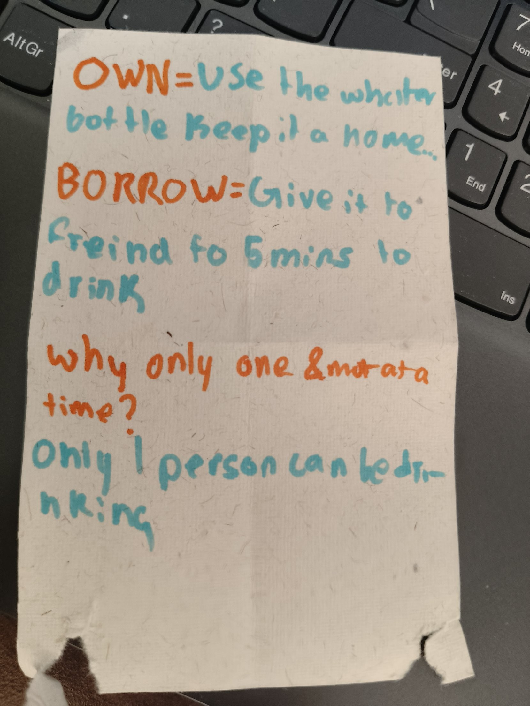
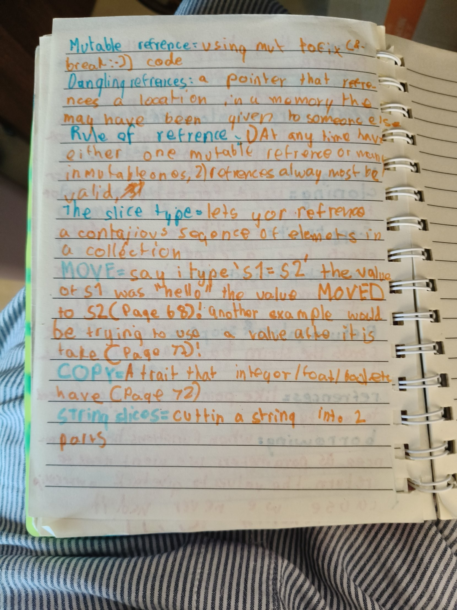
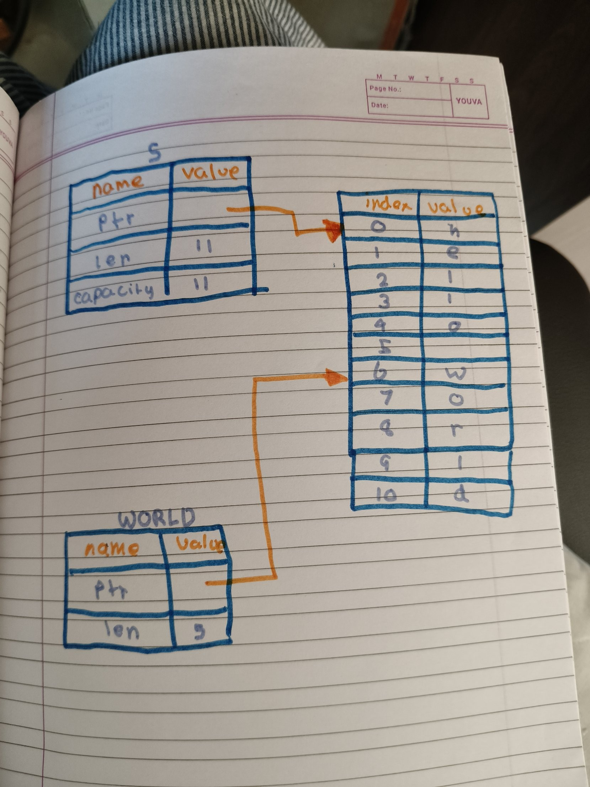

## Break-it lab
Today I broke my own programs on purpose and guessed what Rust would say. Then I found where the book says it.

**A. `let s2 = s1` without `.clone()`, then print both.**
- Before the line s1 owns the text, after it s2 does. (I was reminded to point at my card first. MOVE.)
- PREDICT: No, s1 drop value. **Tick**, but my word was wrong. Rust says "value moved here". The value moved to s2, it was not dropped.
- Book: page 68.

**B. Print `s` after `takes_ownership(s)`.**
- Before, `s` owns it. After, `some_string` owns it. I pointed at MOVE.
- PREDICT: No, it moved. **Tick.**
- Book: page 72.

**C. Print `x` after `makes_copy(x)`.**
- First I printed `s` by mistake. (I needed a clue.)
- PREDICT: Yes, a copy is not moving, it is borrowing. **Tick.** It printed 5 two times. "Not moving" was right. "Borrowing" was the wrong word, it is a copy.
- Book: page 72.

B and C look the same, but one was moved and one was copied.

**D. `calculate_length`, no change.**
- PREDICT: the lenght of 'hello' is 5. **Tick**, exactly.
- Why can I use s1 after the call here, but not in B? Here the variable was moved nowhere, it stayed there, but there it got moved before we used it.
- The difference in the code is the `&`. (I needed two clues to find it. First I said `::`.)
- The friend is `calculate_length`, the owner is s1.
- Book: page 74.

**E. Two `&mut` to the same `s`.**
- It took me a few tries to find the right example in the book.
- 1 owner, 2 borrowers.
- PREDICT: No, because 2 people cannot borrow at the same time. **Tick.** Rust says "cannot borrow `s` as mutable more than once at a time". (I needed a clue to see the word mutable.)
- Book: page 76.

**F. The book's fix: `r1` inside its own curly brackets.**
- 1 borrower at a time.
- PREDICT: Yes, it is possible to have one, not two. **Tick**, with warnings.
- Book: page 77.

Six predictions, six ticks. Two of them had a wrong word in my why.

## My new card
- OWN = Use the water bottle, keep it at home.
- BORROW = Give it to a friend for 5 mins to drink.
- Why only one `&mut` at a time? Only 1 person can be drinking from one water bottle at a time.



For three mornings I said "two owners" when I was asked why Rust refuses two `&mut` to the same `s`. Today I said: 2 people cannot be drinking at once.

My notebook lines for MOVE and COPY:



## Rust book: String Slices
I read pages 82 to 84 and typed the book's example that makes hello and world:

```rust
fn main() {
    let s = String::from("hello world");

    let hello = &s[0..5];
    let world = &s[6..11];
}

```

My notebook line: String slices = cutting a string into 2 parts.

I copied the book's picture:



- A string slice holds a pointer and a length. (First I said s and world. Then I read it off my drawing.) Book: page 82.
- `s` owns the text. The slice does not own it. (I was reminded to point at my card first.) Book: page 80.
- Is a slice OWN or BORROW? First I said OWN, we own parts of it. Then I looked at my card and my code: BORROW, it has this symbol `&`.

## Petzold
- The extra bit on my Full Adder drawing is carry in.
- For 8 bits you need 8 full adders, and each carry out goes to the next adder.
- My Chapter 15 line about analog and digital did not match the book. I have not finished fixing it.

## Moonlight
Before the lab I published my Moonlight Build Day 11, Sprint #2 post.
