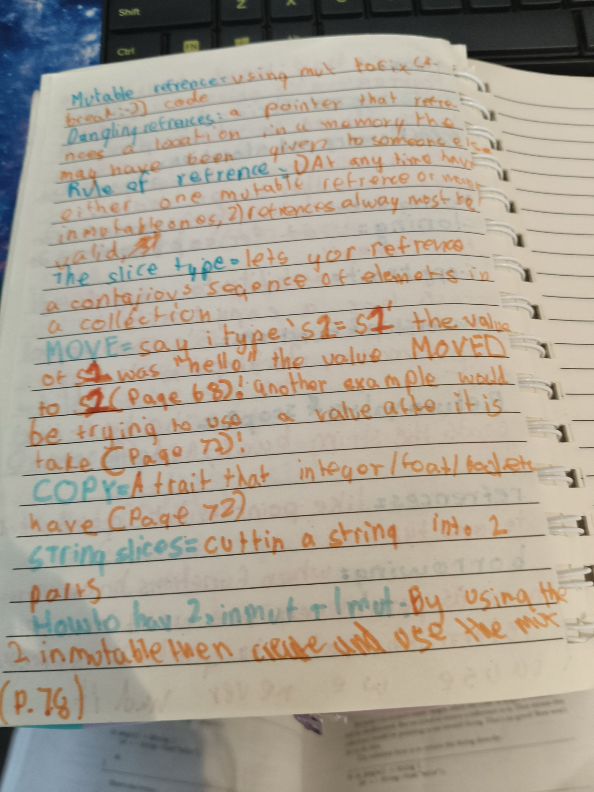
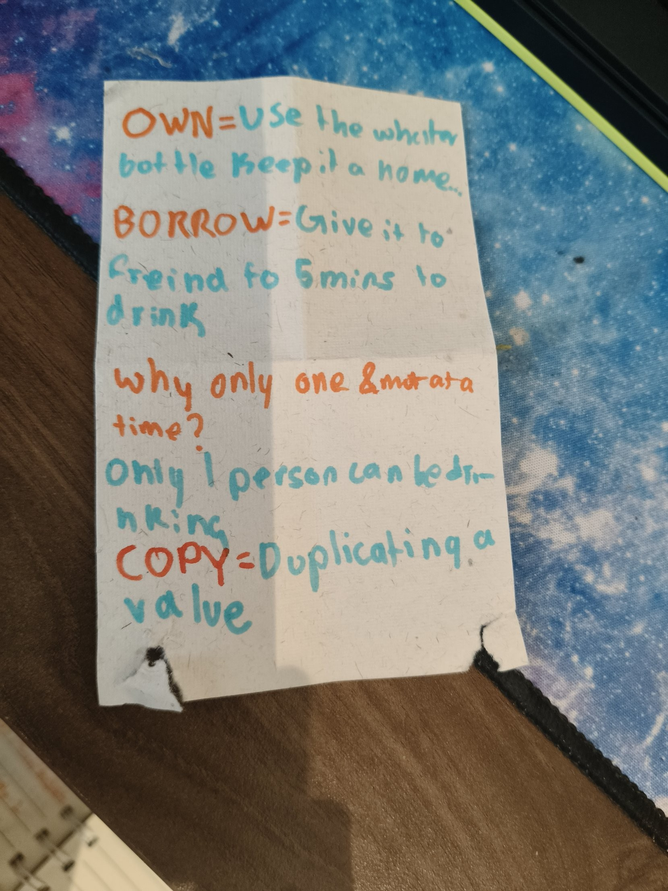
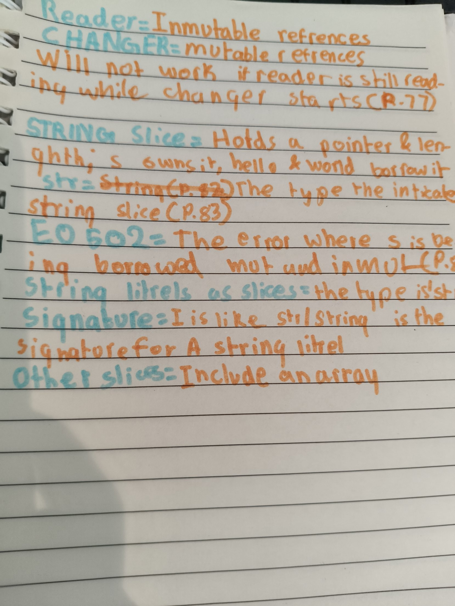
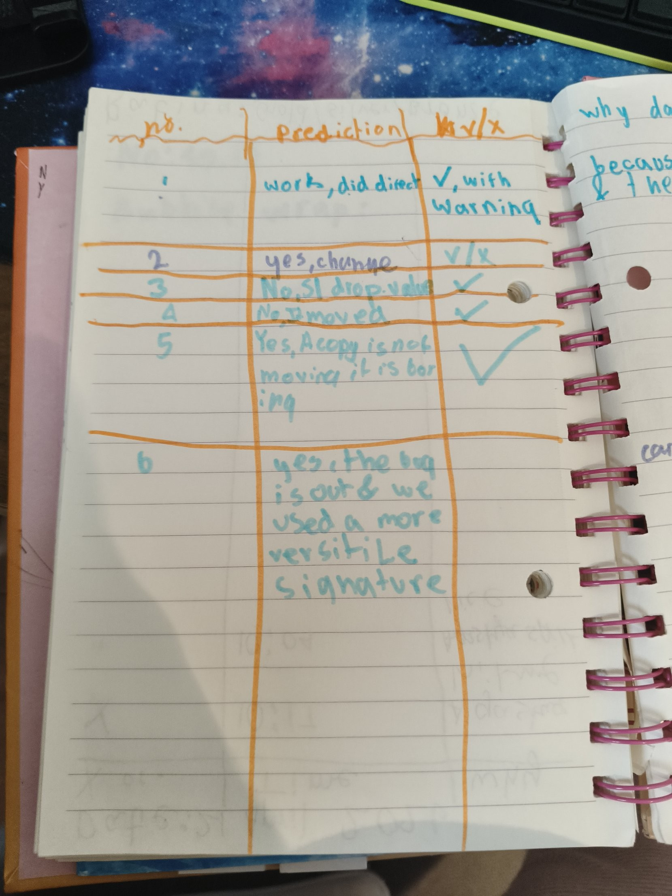
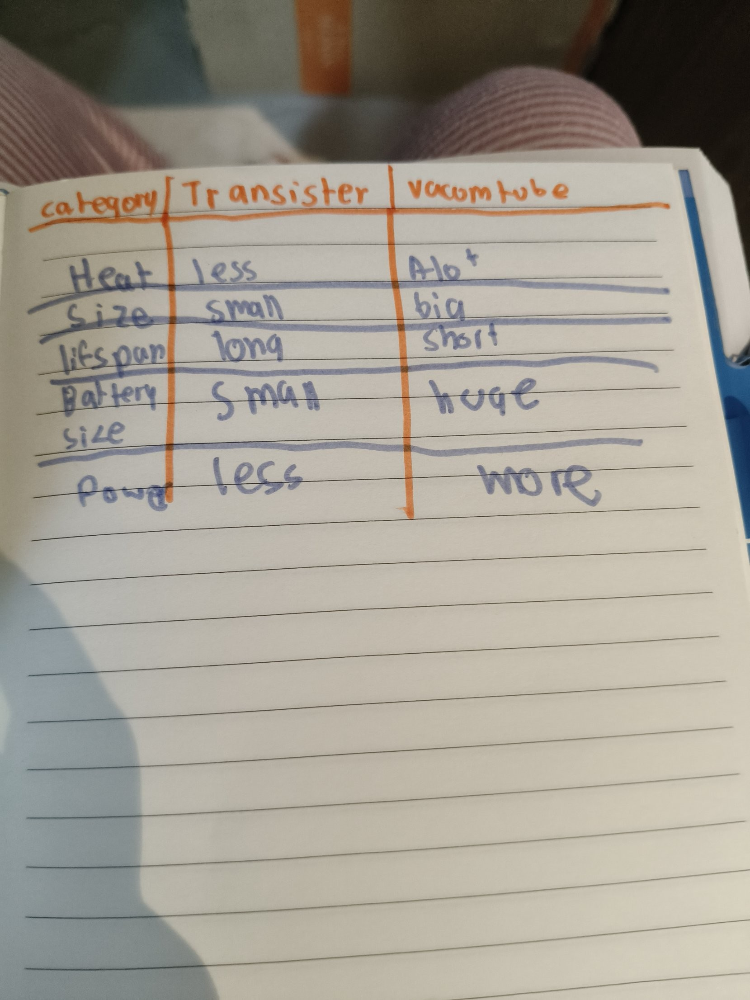

## Two cold questions
- Why does Rust refuse two `&mut` to the same `s`? 2 people can not be drinking from 1 bottle. (I was reminded to point at my card first. Card 2, BORROW.)
- Why could I print s1 after `calculate_length`, but not `s` after `takes_ownership`? `calculate_length` borrowed. The symbol is `&`. (I was asked for the symbol and the card.)

## Two fixes
- My MOVE line now says `s2=s1`: the value of s1 was "hello", the value MOVED to s2. (First I swapped all the names. I needed a clue to fix the rest.)
- Is a copy the same as a borrow? No. COPY = Duplicating a value.

## Slices lab

**G1. Two readers, then a changer (page 78).**
- Readers are r1 and r2, and they are finished. I said the changer is the print. `r3` is the one with `mut`.
- PREDICT: yes, we used it before taking another one, it will print hello, hello and hello. **Tick** for compiles. **Cross** for the lines: it printed `hello, world and hello, world` and then `hello, world`. The `, world` came from my `change` function on lines 10-13.
- My line: How to have 2 immut + 1 mut: by using the 2 immutable, then create and use the mut (p.78).

**G2. The print moved to after r3 (page 77).**
- First I said readers are print and changers are the references. Then, from my own notebook line: the 2 immuts read, the mut changes, and no, the readers are not finished.
- PREDICT: no, the readers are not finished. **Tick.** Rust said E0502.
- My lines: Reader = immutable references. CHANGER = mutable references. Will not work if reader is still reading while changer starts (P.77).

**H. Print `s` after hello and world are made.**
- s owns it, hello and world borrow it. I pointed at the first 2 lines on card 2.
- First I put the print above the slices and had to move it.
- PREDICT: yes, it will print hello world. **Tick.**
- Was `s` cut? NO. My old line said "cutting a string into 2 parts". I asked "how" two times, and I needed a clue: two things I had already said. My new line: STRING Slice = Holds a pointer & length; s owns it, hello & world borrow it.

**I1. `first_word` hands back a slice (page 83).**
- First I only added the main and left the old function. Then I changed the three lines.
- s owns it, word borrows it. Card 2, lines 1 and 2.
- PREDICT: it will work because `s.clear()` is an error. **Tick.** It printed `the first word is: hello`. My exact line did not count, because I ran before it could be read.
- My line: str = the type that indicates string slice (P.83). (First I wrote str = String, P.82. I fixed it from the book.)

**I2. Add `s.clear()` (page 84).**
- PREDICT: no, because if we clear it nothing is left. **Tick**, but my why was not Rust's reason. Rust said E0502: cannot borrow `s` as mutable because it is also borrowed as immutable.
- Which other experiment gave the same number? I said I don't know. Reader is word. I said there is no changer, then I said the changer is word. I have not got this one yet.
- My line: E0502 = The error where s is being borrowed mut and immut (P.84).

## The last two pages of Chapter 4
- In `first_word` I changed the first line to `s: &str` (page 85).
- PREDICT, row 6: yes, the bug is out & we used a more versatile signature. The first word is hello world. **Tick** for compiles. **Cross** for the line: it printed `the first word is: hello`. Why only hello? At place `i` there is a space. (I needed a hint.)
- A string literal's type is `&str` and it is stored inside the binary (page 85). First I said the heap.
- Now a string slice can pass (page 85).
- Other slices include an array (page 86).
- Strongest on ownership, weakest on slices.

Six runs with a PREDICT. All six yes or no were right. Two exact lines were wrong, one why was wrong, and one exact line did not count. Only row 6 is on my scorecard page. The others were in chat.

**Chapter 4 is finished.**

## Git
I opened a terminal in my projects folder and ran `git rev-parse --show-toplevel`. I guessed it would say "all". Git said: `fatal: not a git repository`. So we deleted nothing there.

We stopped it because there was no repositrey!!!

In Temperature-Converters I deleted the lone `src` folder. My note: "delete the lone src folder with nothing right in it and useless".

## Petzold
- I found the word digital on page 187: "From the first digital computers in the 1930s". My analog and digital line is not fixed yet.
- I read pages 190 and 191 and made a table.

| category | Transistor | vacuum tube |
|---|---|---|
| Heat | less | a lot |
| Size | small | big |
| Lifespan | long | short |
| Battery size | small | huge |
| Power | less | more |

