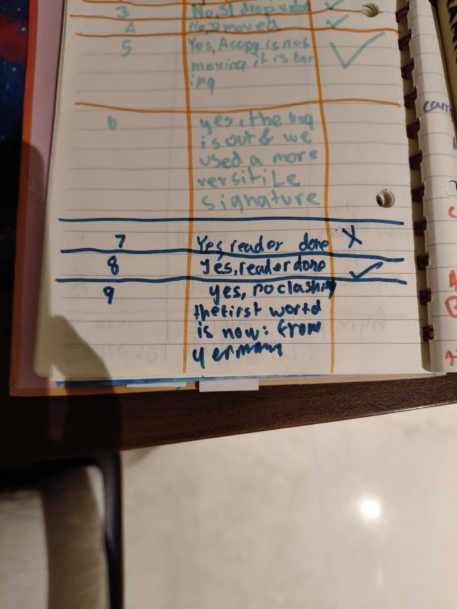

## Two cold questions
- Which one symbol lets me use s1 after `calculate_length`, and what is the word on my card? `&`, borrow.
- My reader and changer rule: "Reader is mutable, changer is not. Changer can not start before reader is done." The second half is my rule. The first half was the wrong way round, and I changed my notebook lines the wrong way too. Then I looked at Rust's words and put them back: Reader = immutable references, CHANGER = mutable references.

## Changer lab

**J. A `push_str` line between the `word` line and the print (page 84).**
- First I asked how. I needed a clue: the `push_str` line in my own `change` function.
- Reader is `word`. (I was reminded to point at my card first.)
- Which line is the changer? I said line 2, the `let mut s` line. I read the sentence that begins "Recall" on page 84 and still said line 2.
- Is the reader finished when the changer starts? I said no.
- PREDICT, row 7: Yes, reader done. **Cross.** Rust said E0502: cannot borrow `s` as mutable because it is also borrowed as immutable.
- Rust marked line 4, my `push_str` line, "mutable borrow occurs here". So the changer is line 4.
- My line: There can't be an immutable borrow -> mutable borrow -> immutable used (P.84).

**K. The same `push_str` line, moved to after the print.**
- The changer is line 5 now, and the reader is finished. (I was reminded to point at my card and I did not.)
- PREDICT, row 8: Yes, reader done. **Tick.** It printed `the first word is: hello`.

Which experiments yesterday gave the same error number as J? I said G1, then H. I have not got this one yet.

In my project `two` the changer is line 6, the `&mut s` line.

My new lines on the back of card 2:
- Changer = A mutable reference
- Reader = An immutable reference
- immut -> mut -> immut will throw an error


## Slices

**L. `first_word` with my own text, "from germany" (page 85).**
- First I wrote `s.first_word(...)`. I needed a clue: the shape of my own line 3. Then I made a new name, `full`.
- PREDICT, row 9: yes, no clashing. The first word is now: from germany. **Tick** for compiles. **Cross** for the line: it printed `the first word is changed to: from`.
- Why only "from"? Because we asked it to print till the ' '.
- A string literal's type is `&str` (page 85). My notebook line said 'str'. I added the `&` from the book. (For the blog I first said page 84.)
- My Signature line: I checked it against page 85 and kept it.

## My own program
Chapter 4 is finished, so I started a program of my own.

- At first I had no idea. I picked "a secret code maker" from three titles, then I wanted gymnastics, then my whole list of activities.
- I found a problem: "if we say 5, what if it goes to the other 5?" My fix: am and pm.
- I could not plan it on paper, so I asked to act it out. I was the program and my tutor (Claude AI) was the user.
- As the program I asked 31 questions: sports, studies, free time, wake up, bedtime, meals, snacks, driving time.
- Then I typed the schedule my program should print. It starts like this:

```
4am -> wake up
4am -> get ready for swim
4:30am -> leave
5am -> swim
7am -> come back
7:30am -> eat a meal
```

- Second try: the basics first, "(or type none)" for a question you can skip, and it asks "am/pm" if you only type 5.
- It asks you questions then makes your schedule. I did what I wanted on the second try.
- There is no paper plan and no code yet. I will not touch the paper till I understand it.

## Swim README and Git
- My swim README went up from the GitHub website last time, with a note Copilot wrote. Today I pulled it in VS Code and added the full steps: `cargo new swim_celobrator`, paste into `main.rs`, `cd swim_celobrator`, `cargo run`. My note: "add full steps to readme".
- Git: inside `string_slices` I ran `git rev-parse --show-toplevel`. I guessed "all". It printed `C:/Users/LENOVO/projects/string_slices`. `git status` said "No commits yet".
- I checked why there is a 197 badge on Source Control. Found when you make a cargo project it makes git.

## Petzold
- What did engineers begin building computers from in the 1930s? Relays (page 186). No hint this time.
- I crossed out my old line. My new line: The first computers used relays (P.186).
- No new reading today.


## Predictions
Three runs, and a photo of the scorecard row before each one. Row 7 cross, row 8 tick, row 9 tick for compiles and cross for the line. My count: 2 crosses, 1 tick.

