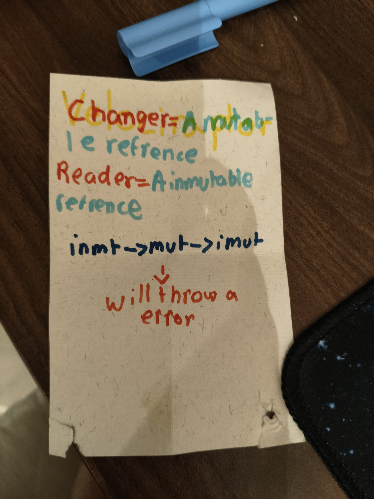
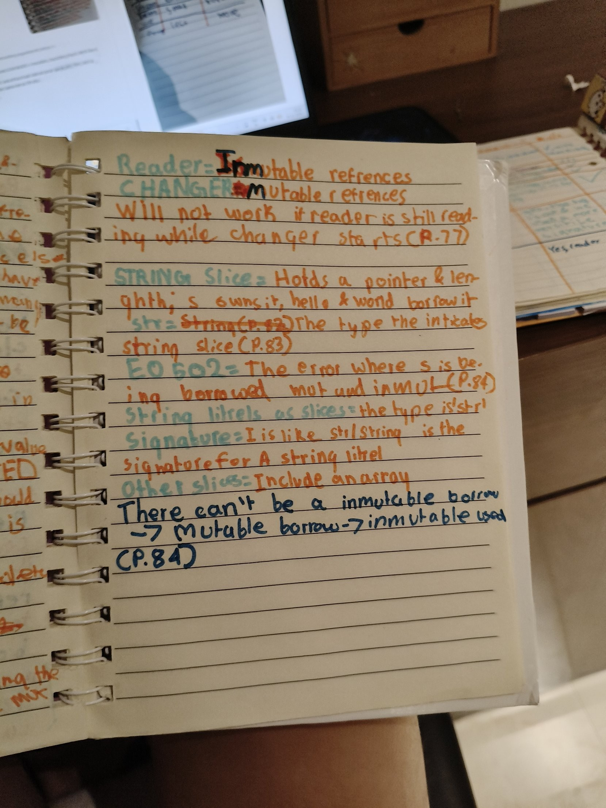
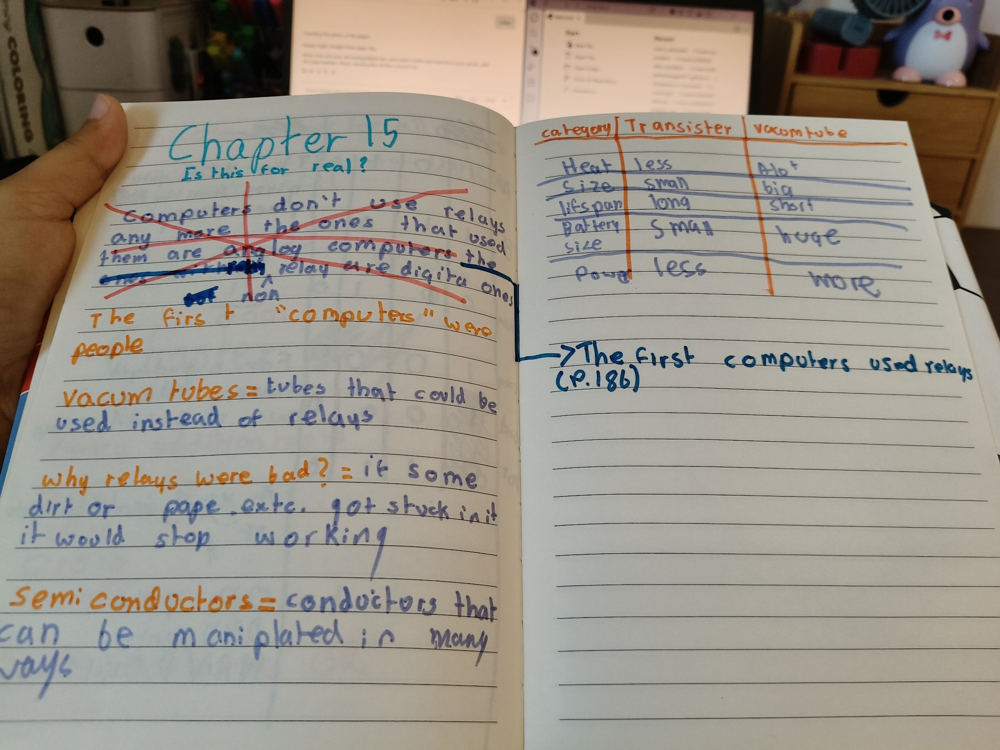

## Readers and changers
Changer is mutable, reader isn't.

## Slices
`&str`. I don't know.

From.

## My own program
It asks you questions then makes you schedule. Today what did was asked my tutor (Claude AI) to be the user. I did what I wanted on the second try.

## Git
I checked why there is a 197 badge on Source Control. Found when you make cargo project it makes git.

## Petzold
On 186 that computer the first ones were made of relays and I fixed my line.

## Predictions
2 crosses 1 tick.

