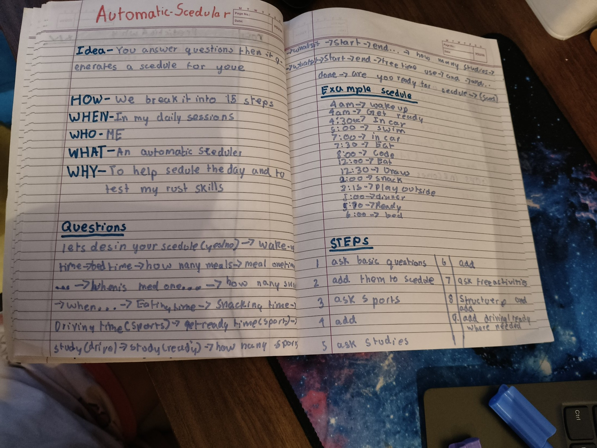
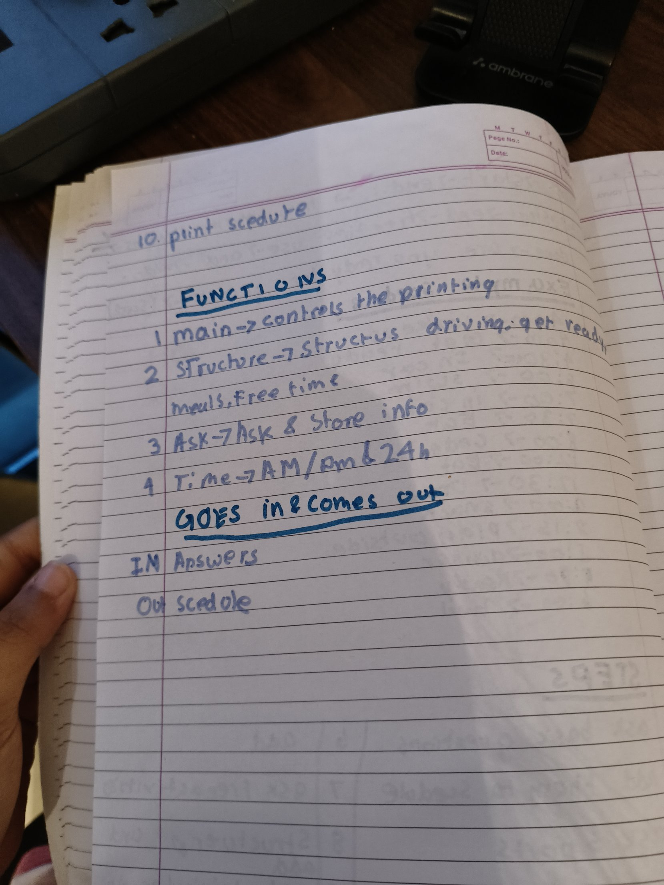
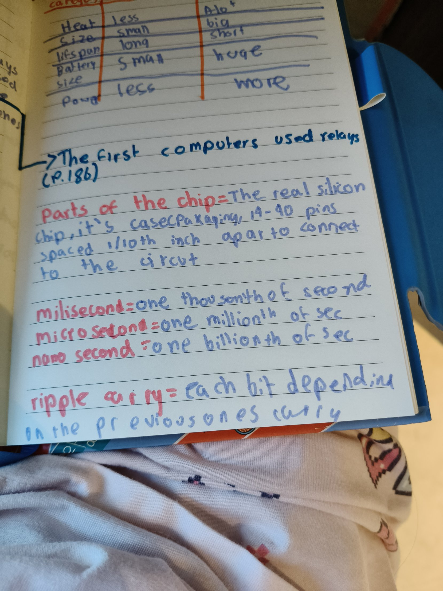
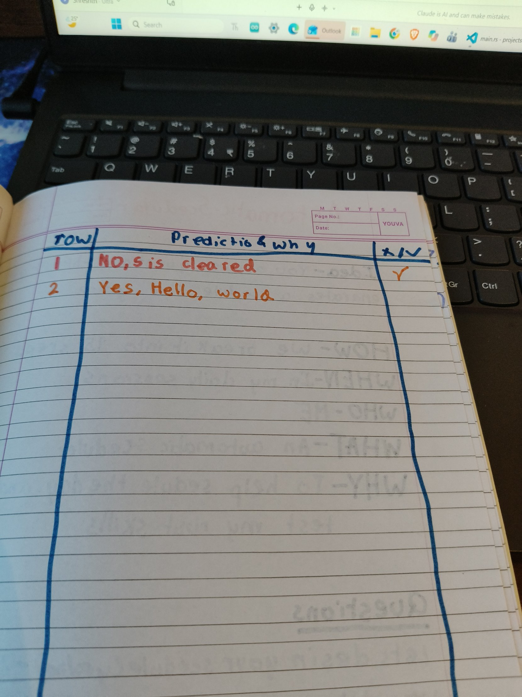

## Two cold questions
- Which one is the mutable reference, the reader or the changer? Changer. I pointed at the back of card 2.
- My rule: "A changer can't start until the reader finishes." Back of card 2 again. Nobody had to remind me to point this time.

## Changer lab

**M. In `string_slices`: `let mut s`, a line that clears `s` after `hello` and `world`, then print `hello` (page 84).**
- First my print line printed the word "hello". Then I changed it to print the thing named `hello` from line 4.
- I had no scrap paper, so I typed my line numbers.
- First time: readers are lines 4 and 5, changer is line 7, reader is not used.
- Second time, after I fixed the print: changer is line 2, readers are 4 and 5, last used on line 9.
- PREDICT, row 1 of my new scorecard page: No, s is cleared. **Tick.** Rust said E0502: cannot borrow `s` as mutable because it is also borrowed as immutable.
- I said it won't work. Rust said the same, but for a different reason.
- Rust marked line 7, `s.clear();`, "mutable borrow occurs here". That did not match my second answer, line 2. It matched my first answer, line 7.
- No new notebook line. I have already written this one many times.
- Which experiments are my E0502 lines from? My notebook doesn't say.
- Was `s.clear()` the changer? Yes, it changed s. I left my card as it is.
- With the error I realised `s.clear()` was a changer.

## My own program
It is called **Automatic-Scedular**. You answer questions, then it generates a schedule for you.

- My problem: how will we get the computer to know am and pm and make the schedule?
- The smallest version is just a println line. One line is `4am -> wake up`, and for that the program has to remember the wake up time.
- For bedtime the user types `7pm`. Put the pm in the first place.
- Then I made my paper plan: the idea, HOW, WHEN, WHO, WHAT and WHY, my questions, an example schedule, and ten steps.
- My four functions: main controls the printing. Structure structures driving, get ready, meals and free time. Ask asks and stores info. Time is AM/PM and 24h. IN: answers. OUT: schedule.
- I made the project with `cargo new` inside `projects`.
- I kept asking how. My tutor (Claude AI) was not allowed to tell me. My swim program was no help, because it has seconds, not am and pm and the 24 hours of the day.
- So I figured it out myself. On Google I found `chrono = "0.4"` to put under `[dependencies]` in `Cargo.toml`, like the guessing game in the book.
- PREDICT, row 2: Yes, Hello, world. **Tick.** It printed `Hello, world!`. I had already run it once before my prediction.
- What does it do so far? Nothing yet. What is not done? Everything. Step 1 is next.

## Petzold
I read the last 5 pages of Chapter 15, from page 192. Chapter 15 is done.

- Parts of the chip = the real silicon chip, its case (packaging), and 14 to 40 pins spaced 1/10th of an inch apart to connect to the circuit.
- Millisecond = one thousandth of a second. Microsecond = one millionth of a second. Nanosecond = one billionth of a second.
- Ripple carry = each bit depending on the carry of the one before it.
- The main thing on those pages: the chip (page 193).

## Predictions
Two runs, and a photo of the scorecard row before each one. Row 1 tick, row 2 tick. My count: 2 ticks.

