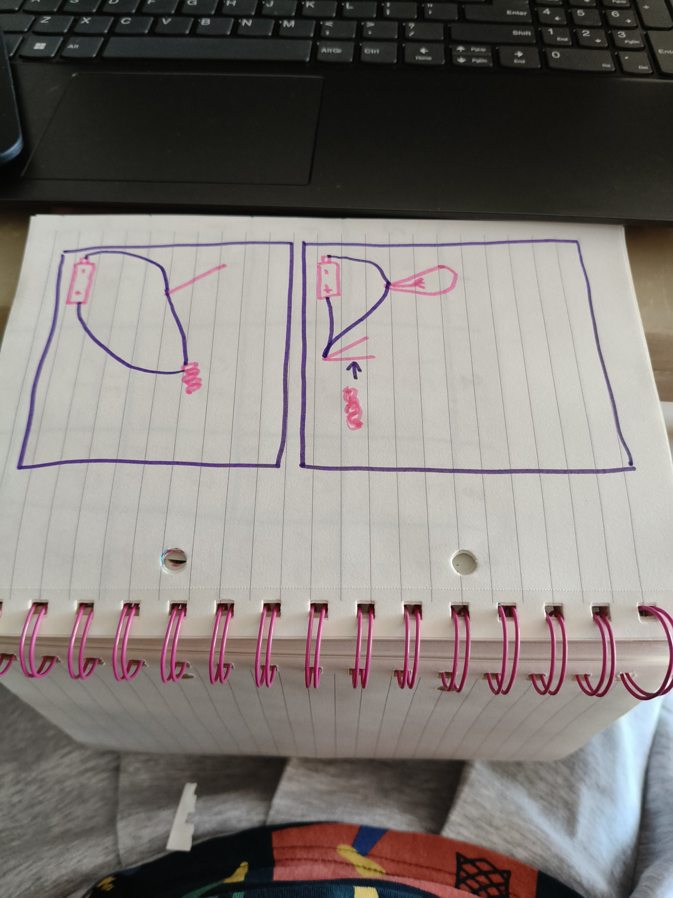

Yesterday I filled dynamic programming grids on paper. Today I turned my swim bag grid into code.

## The grid in code
A grid is a list of lists. Each row is a list of zeros, and the grid is a list of rows. To get one box you use two square brackets: grid[2][3] is row 2, column 3.

I added an extra row and an extra column full of zeros. The extra row means "I own nothing yet," so the first item has a box above it to compare with.

## The box rule
For each item and each bag size:
- skip = the box above
- if the item fits: left = bag size minus the item's slots, and take = the item's points plus the box above in column left
- the box becomes the bigger one, using max

If the item doesn't fit, the box just copies the box above. You can't jam a 5-slot kickboard into a 2-slot bag!

    for _ in range(rows):
    row = [0] * cols
    grid.append(row)
 = 1
    for item in stuff:
        for c in range(1, cols):
            slots = stuff[item]["slots"]
            points = stuff[item]["points"]
            skip = grid[r-1][c]
            if stuff[item]["slots"] <= c:
                left = c - slots
                take = points + grid[r-1][left]
                grid[r][c] = max(skip, take)
            else:
                grid[r][c] = skip        
        r += 1

## Bugs I fixed
- My row counter went up before the inner loop, so the kickboard ended up in row 6, which doesn't exist. I moved r += 1 to the end.
- When I changed bags, it said "list index out of range" because I still printed grid[5][5]. Now it prints grid[rows - 1][bag], so I only have to change Bag.py.

## It works
My swim bag printed 50, and pencil, eraser and laptop printed 40. Greedy only got 45 and 30.

## Relays (Petzold Chapter 8)
A button needs a finger. A relay doesn't. In a weak circuit, a button sends current through a coil, and the coil becomes an electromagnet. It pulls a metal flap that closes a strong circuit with its own battery, so the bulb lights up. One circuit controls another!

If the flap starts closed and the magnet pulls it open, the light is on until I press. That's a NOT gate.

My gate table:
- NOT: on when the input is off
- AND: on when both are on
- OR: on when either is on
- NAND: on unless both are on
- NOR: on only when neither is on

NAND and NOR were tricky for me. They're the opposites of AND and OR.

## What's next
Make my program print WHICH items went in the bag, not just the points.
