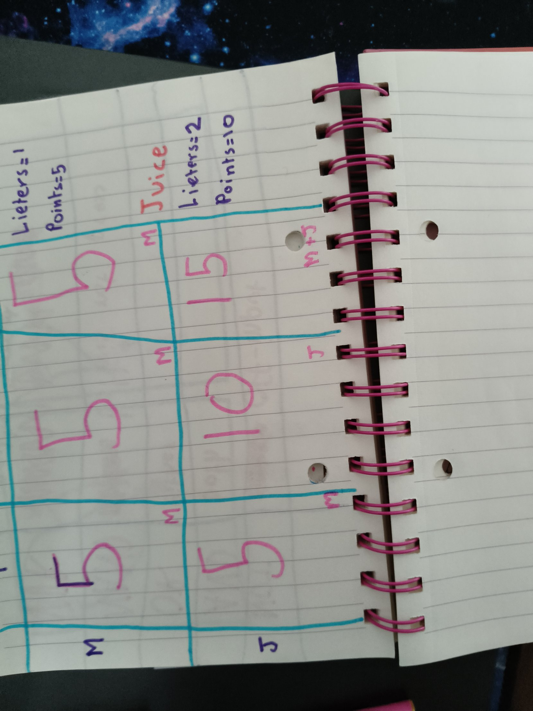
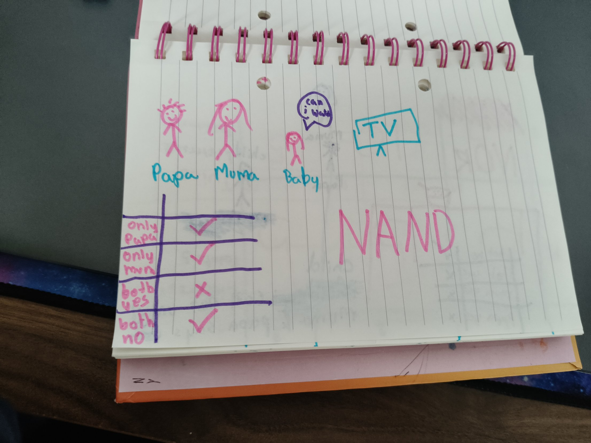
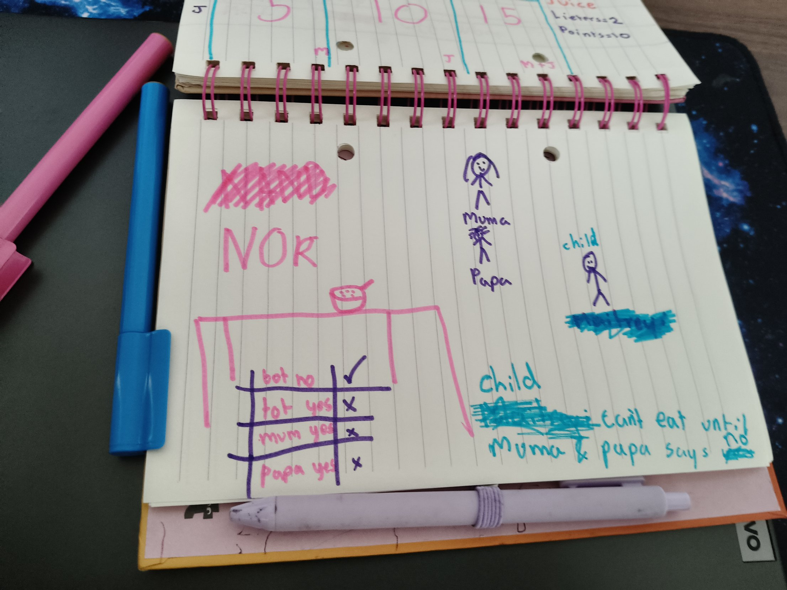
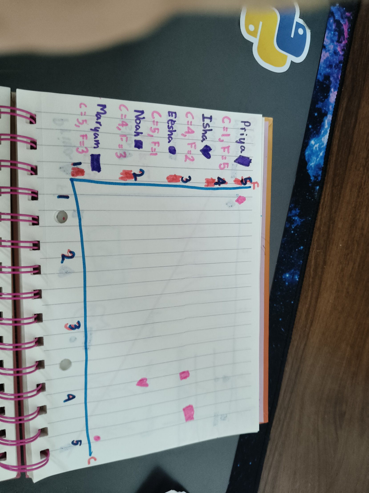

## Which items went in the bag?
Yesterday my program said my swim bag was worth 50, but it didn't say WHICH things were in it. So I made it walk backwards through the grid, like Dijkstra walking back through parents.

Start at the bottom-right box and compare it with the box above:
- Same number: that item was NOT taken, because it didn't add anything. Move up a row.
- Different number: that item WAS taken. Take away its slots, then move up.

On paper I found Cap, Goggles and Pull Buoy. The fins box was 25, the same as the box above, so no fins!

    r = rows - 1
    c = bag
    taken = []

    while r > 0:
        if grid[r][c] != grid[r-1][c]:
            name = list(stuff)[r-1]
            taken.append(name)
            c = c - stuff[name]["slots"]
        r = r - 1

My program printed ['Pull Buoy', 'Goggles', 'Cap']. It was backwards because I walked from the end, so I used reverse(). My prediction matched!

For pencil, eraser and laptop it first said Laptop, 30. I had typed the pencil as 2 slots instead of 1. With 2 slots the pencil and eraser don't fit together, so Laptop really was right for that data! After fixing it, it said Pencil and Eraser.

## My own grid
I made a milk and juice grid and explained the last box by myself: skip the juice (5) or take the juice plus milk (15). 15 wins.

## NAND and NOR
I made real-life versions with my family.

NAND: the TV stays on unless BOTH Papa and Mumma say yes to turning it off. Only "both yes" turns it off.

NOR: my first try was supposed to be NAND, but it only had one tick. The child eats only when neither says yes. That's NOR!

## Nearest neighbours
Grokking Chapter 10: to guess what someone likes, look at people with similar tastes and go with the majority. I rated chocolate and fruit for Priya and 4 friends and plotted them. All my friends love chocolate and Priya loves fruit, so they're all far away! Noah was the least far. Next time I'll learn how a computer measures distance.

