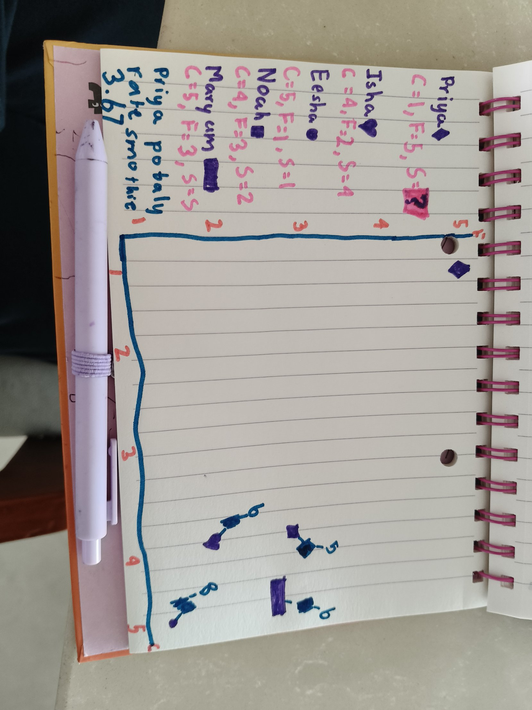
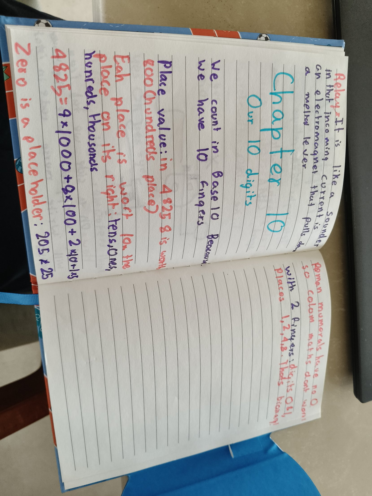

## How far is far?
Priya and her friends rated chocolate and fruit from 1 to 5. If they lived on a grid of streets, Priya would walk 5 blocks to Noah: 3 across and 2 down.

But a crow flies straight. So the computer squares each part and adds them: 3 × 3 + 2 × 2 = 13. Noah 13, Isha 18, Maryam 20, Eesha 32. The smallest number means the most similar tastes.

You can't just add someone's ratings together. Priya (1 + 5) and Eesha (5 + 1) both make 6, but they have opposite tastes!

## The mango smoothie
Then a new mango smoothie came out. Priya hasn't tried it, so her rating is a mystery. Her 3 nearest friends rated it Noah 2, Isha 4 and Maryam 5. On paper I added them up (11) and divided by 3: Priya would probably rate it 3.67.

## The code
I made a `distance` function and a `find_closest` function. `find_closest` is like `find_cheapest` from Dijkstra: it keeps the lowest distance and skips Priya and anyone already chosen. It runs 3 times to find the 3 nearest.

(paste your code here)

It printed ['Noah', 'Isha', 'Maryam'] and 3.6666666666666665, the same as my paper answer! We trust the nearest friends because their tastes are most like Priya's. Eesha is too far away.

## Petzold: Our Ten Digits
We count in tens because we have ten fingers. In 4,825 the 8 is worth 800 because it's in the hundreds place. Zero is a placeholder, so 205 isn't 25. With 2 fingers we'd only need the digits 0 and 1, and the places would be 1, 2, 4, 8. That's binary!

