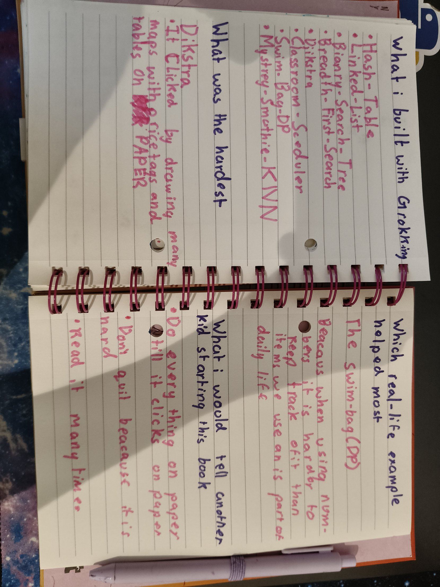

## I finished the book!
Today I read Chapter 11, the last chapter of *Grokking Algorithms*. I built every big idea from the book myself, book closed, paper first:

- [Hash-Table](https://github.com/kashishdugar2017/Hash-Table)
- Linked-List
- [Binary-Search-Tree](https://github.com/kashishdugar2017/Binary-Search-Tree)
- [Breadth-First-Search](https://github.com/kashishdugar2017/Breadth-First-Search)
- [Dijkstra](https://github.com/kashishdugar2017/Dijkstra)
- [Classroom-Scheduler](https://github.com/kashishdugar2017/Classroom-Scheduler)
- [Swim-Bag-DP](https://github.com/kashishdugar2017/Swim-Bag-DP)
- [Mystery-Smoothie-KNN](https://github.com/kashishdugar2017/Mystery-Smoothie-KNN)

## My 3 favourites from Chapter 11
- **Linear programming**: trying to swim the most with limited time. It's like my swim bag!
- **Diffie-Hellman**: keeping secrets, like a secret club in the middle of the night. It reminded me of the Caesar cipher I built from *The Big Book of Small Python Projects*.
- **Inverted indexes**: they store which words are on which pages, like the index at the back of a book. It's like my hash table.

## Looking back
- **Hardest:** Dijkstra. It clicked when I drew lots of little maps with price tags on paper.
- **Most helpful real-life version:** my swim bag. When using numbers it is harder to keep track than with items we use, because they are part of daily life.
- **My advice:** Do everything on paper till it clicks on paper. Don't quit because it is hard. Read it many times.

## My SciPy India poster
I submitted a poster proposal to [SciPy India 2026](https://scipy.in/2026) about how I learn: **make it mine, paper first, then code.** The organisers are reviewing it. [Here is my proposal.](https://cfp.scipy.in/scipy-india-2026/talk/review/QLQFCWMHJZZ89SZNPRKCFYSXRGNE9VVH)

## Petzold: Other Number Bases
We use base ten and it is convenient because we have ten fingers. Zero acts as a placeholder. Without it, 205 would be 25!

If cartoon characters have 8 fingers, they would count 0, 1, 2, 3, 4, 5, 6, 7, 10, 11, 12, 13, 14, 15, 16, 17, 20. There is no 8 or 9.

In binary each finger has 2 positions, up or down. The fingers are worth 1, 2, 4, 8 and 16, so on one hand I can count to 31!

## I started Rust!
Today I started Rust, and it got preponed! From now on, some days will be Rust and some days will be Miller & Ranum and once a week will be rewieng code bases. [Rust-Book](https://github.com/kashishdugar2017/Rust-Book)

