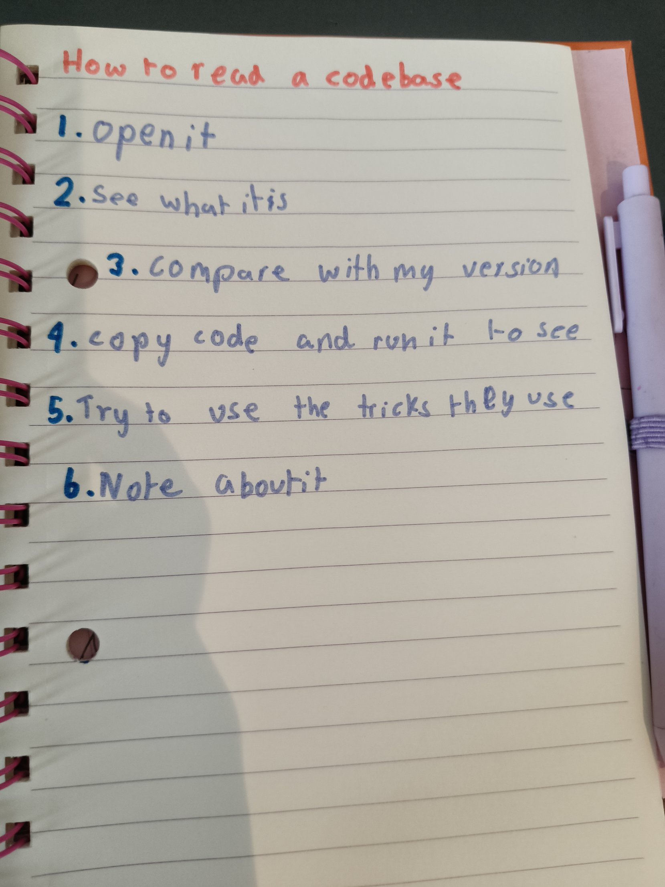
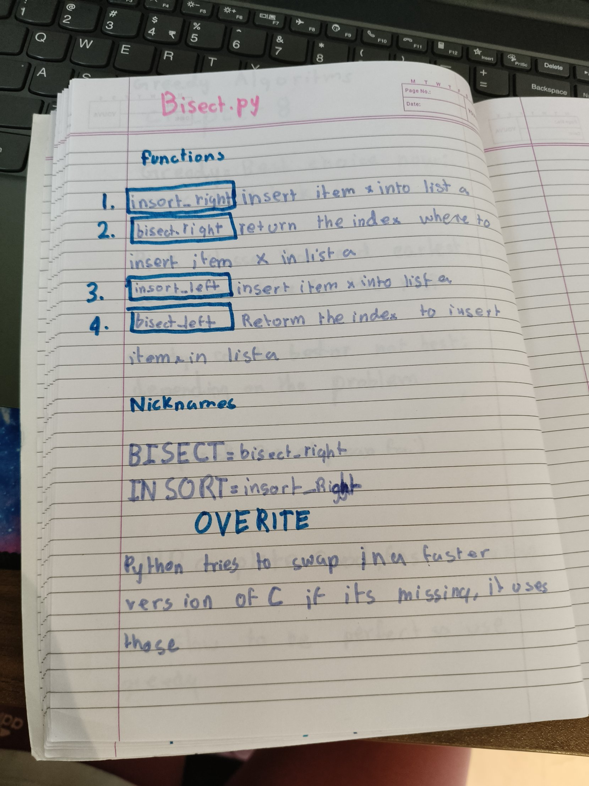
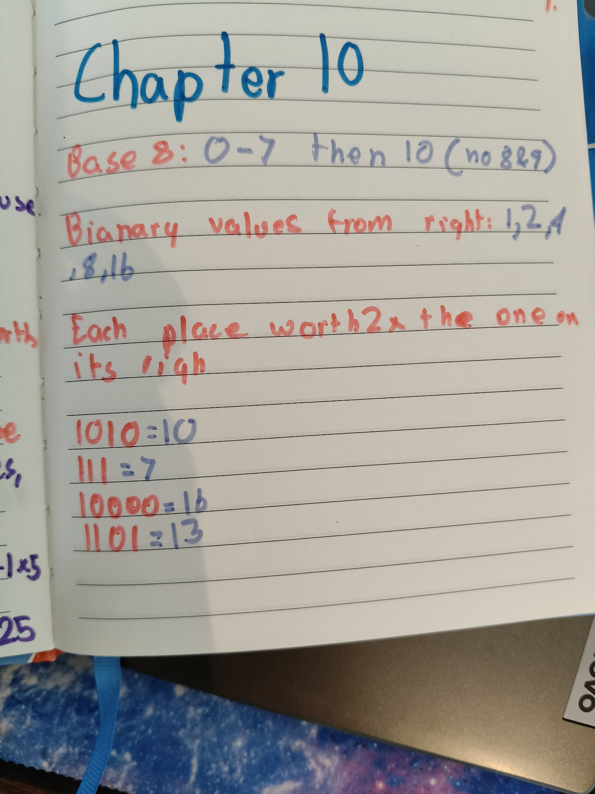

## Codebase of the Week #1: bisect.py
This week I read real code written by Python's own developers: [bisect.py](https://github.com/python/cpython/blob/main/Lib/bisect.py), Python's binary search.

Before opening it, I wrote my plan for reading a codebase:
1. Open it
2. See what it is
3. Compare with my version
4. Copy the code and run it to see
5. Try to use the tricks they use
6. Note about it

### My map of the file
- **insort_right**: inserts item x into list a
- **bisect_right**: returns the index where to insert item x in list a
- **insort_left**: inserts item x into list a
- **bisect_left**: returns the index where to insert item x in list a

At the bottom there are nicknames: `bisect` is `bisect_right` and `insort` is `insort_right`. Python also tries to swap in a faster version written in C. If it's missing, it uses these.

### My predictions
On the list [1, 3, 3, 5]:
- `bisect_left` with 3: I said box 1. Correct!
- `bisect_right` with 3: I said box 3. Correct!
- `bisect_left` with 4: I said box 1, but it was 3. I thought about where a three fits, not a four. A 4 goes between 3 and 5.

**bisect_left puts the new 3 before the other 3s. bisect_right puts it after them.**

An empty list gives 0, and I predicted that right.

### 3 differences from Grokking's binary search
1. bisect is much longer.
2. Grokking only has one function.
3. Grokking find where a item **IS**.Bisect finds where a item **SHOULD GO**

### My question
Why is half the code comments?

## Rust: rebuilding from memory
I wrote all the steps on paper from memory, then built Hello World and Hello Cargo again. I fixed three errors myself: two folders already existed, and I used `print` instead of `println!`.

Then I removed a quotation mark on purpose. Rust said "unterminated double quote string". That means the string started but never ended, so we need to add the quote at the end.

Cargo is for building and running.

## Rust: the guessing game
First I wrote how I'd play a number guessing game with Agastya:
1. Think of a secret number
2. Ask the other person to guess
3. Say too high or too low
4. Repeat till the person gets it right
5. Say right!!!

Then I typed the whole game from Chapter 2. My error was using a semicolon instead of a comma. I guessed 4, 8, then 10, and it said "You win!"

## Petzold: binary again
- Base 8: 0–7, then 10 (no 8 or 9)
- Binary values start from the right: 1, 2, 4, 8, 16
- Each place is worth 2× the one on its right
- 1010 = 10, 111 = 7, 10000 = 16, 1101 = 13

