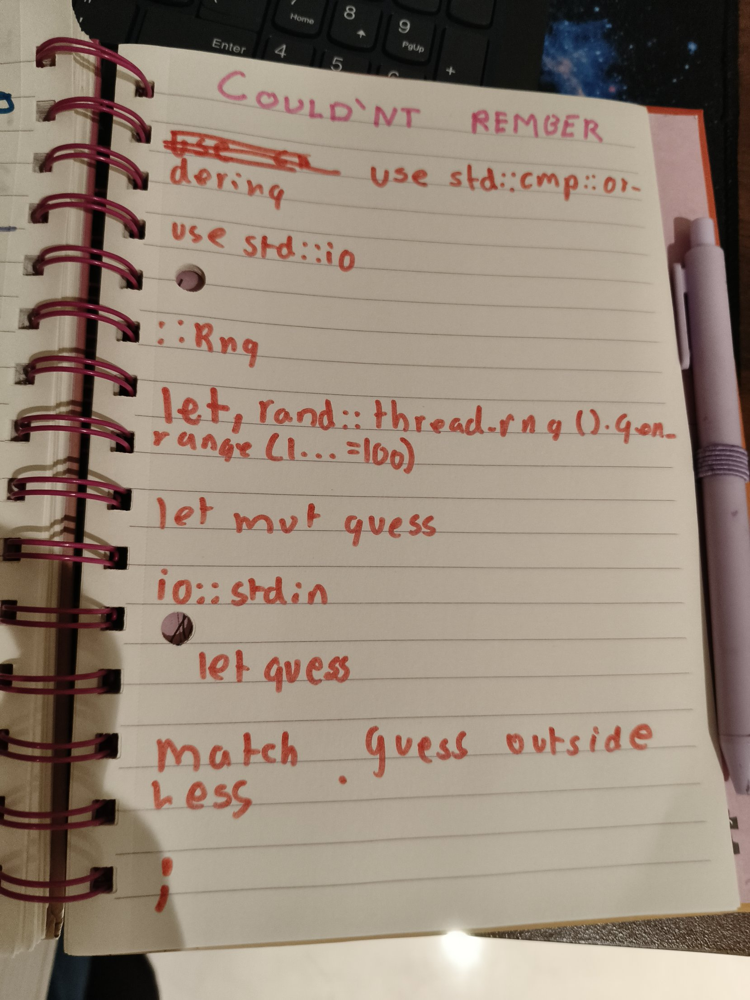
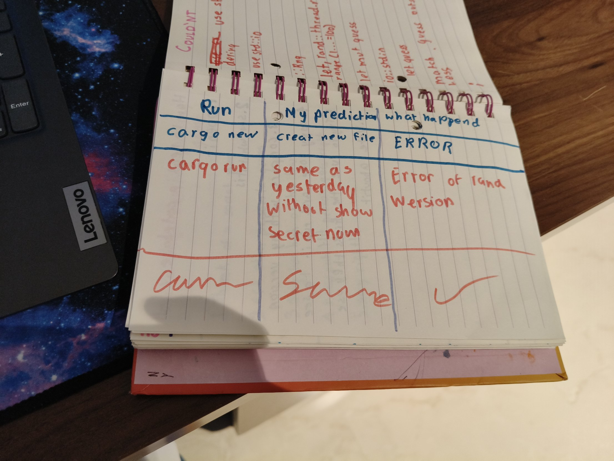
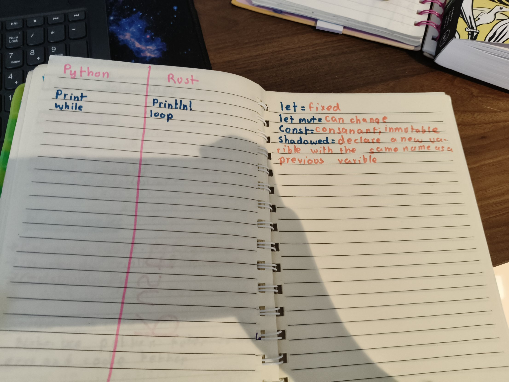
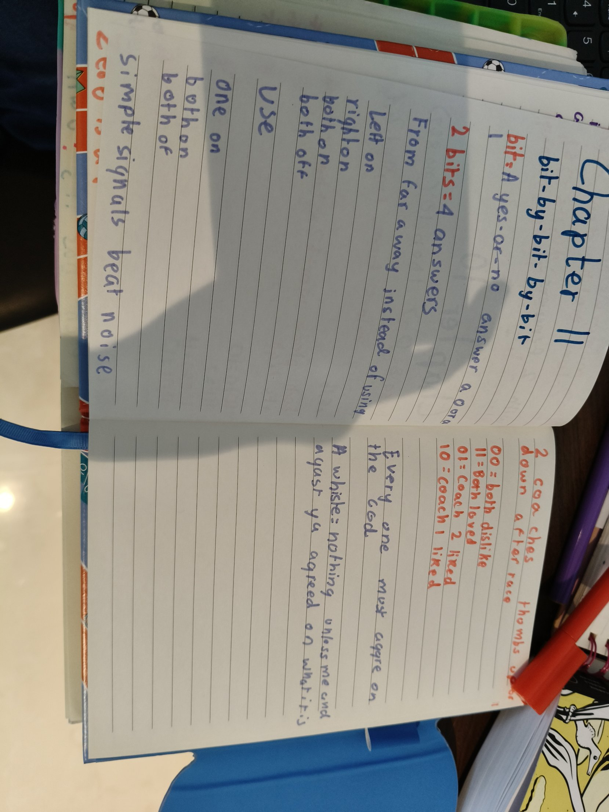

## Rebuilding the guessing game from memory
I had 20 minutes to rebuild my guessing game with the book closed. I remembered the secret number from 1 to 100, the loop, too low and too high, "You win!" and break. Then I opened the book and made a list of everything I couldn't remember.

## What each part means
- **let and let mut:** `let` is like my lane number, it stays the same the whole race. `let mut` is like my lap count, it can change. The secret number uses `let`, my guess uses `let mut`.
- **String::new():** an empty glass, ready before you pour the smoothie.
- **read_line:** pouring the guess into the glass.
- **.expect():** what Rust says if the glass cracks while pouring.
- **Ok and Err:** like a parcel. Ok means it arrived. Err means it came back. If I type a word instead of a number, Err happens and `continue` asks me to guess again.
- **parse:** turns my guess into a number, because a string can't be too high or too low.
- **match:** picks one of three answers: too low, too high or you win.
- **loop and break:** like swimming laps until the coach blows the whistle. "You win!" and break are the whistle.

## My errors
- My Cargo.toml said `rand = 0.1.8`. Rust said "invalid float". It needed quote marks and the right version: `"0.8.5"`.
- I used `>=` instead of `=>` in match.
- I forgot `println!` on the Too high line. Rust said the match arms have incompatible types.

## My prediction page
From today I write my prediction on paper before every run.

## Rust Chapter 3.1: Variables and Mutability
- `mut` means we can change the value. Plain `let` means we can't.
- Shadowing: you write `let` again to make a new variable with the same name.
- Constants are written in ALL CAPS and can never be `mut`.

I also started a Python vs Rust table: `print` is `println!` and `while` is like `loop`.

## Petzold: Bit by Bit by Bit
I always write the place values from the right first. 1100 = 12 and 10101 = 21.

A bit is one yes-or-no answer: a 0 or a 1. To guess which of 4 smoothie flavours someone picked, you only need 2 yes-or-no questions. 2 bits give 4 messages, and everyone must agree on the code. A whistle means nothing unless me and my coach agreed on what it is.

[My Guessing Game](https://github.com/kashishdugar2017/Guessing-Game)
