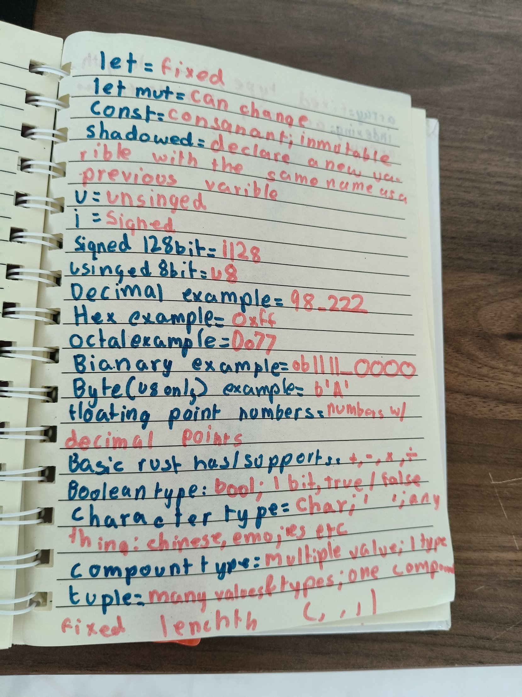

## Data Types
Today I read pages 37 to 49 of The Rust Programming Language and typed the code.

Every value in Rust has a type. All types have different rules, so we tell Rust which type we want. That's why when I parse my guess, Rust needs to know it's a `u32`.

- **Integer:** a whole number. The number of laps I swim is an integer.
- **Float:** a number with a decimal. My race times are floats.
- `u` means unsigned (only positive), `i` means signed. A `u8` holds 0 to 255.
- If you put 256 in a `u8`, a normal run panics. In release mode it wraps around like an odometer, so 256 becomes 0.
- **bool** is true or false. **char** can be any letter, even Chinese or emojis.
- A **tuple** holds many values of different types. An **array** holds values of one type, with a fixed length.

I ran the array example and typed 10 as the index. The array only has 5 things, so Rust panicked: "index out of bounds".

## Finally understanding E0308
Two days ago my guessing game had the error E0308, "match arms have incompatible types". One arm printed "Too low!" and the other was just the text "Too high!". Doing something and being a piece of text are not the same type. All match arms must give back the same type.

## Functions
A function is like a recipe. A parameter is what you hand it each time. If `swim(distance)` was a function, the distance would be 100 m today and 200 m tomorrow. Same function, different input.

An expression gives back a value. A statement doesn't. The last line of a function that returns something has no semicolon, because the semicolon turns it into a statement. Then it gives back nothing, `()`, and Rust says E0308 mismatched types again: expected `i32`, found `()`. Same error as my guessing game!